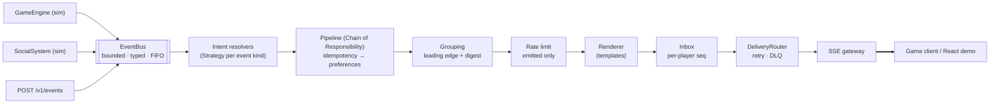

# GameNotify · Real-Time Notification System for a Gaming Platform

A small, production-shaped notification service as a standalone project. It takes **game events** (level up, rare item, challenge, PvP) and **social events** (friend request, friend accepted, new follower). For each event it decides who should be told, checks that player's **preferences**, writes a clear message, and pushes it **in real time** to the game client.

```
gameEngine.playerLeveledUp(1, 15)          → #1 Aria  [GAME/LEVEL_UP]         Congratulations! You've reached level 15!
gameEngine.itemAcquired(2, "SwordOfAzeroth") → #2 Bram  [GAME/ITEM_ACQUIRED]    You've acquired the legendary Sword of Azeroth!
socialSystem.friendRequestSent(3, 1)       → #1 Aria  [SOCIAL/FRIEND_REQUEST] Player 'Kael' has sent you a friend request.
socialSystem.friendRequestAccepted(1, 3)   → #3 Kael  [SOCIAL/FRIEND_ACCEPTED] Player 'Aria' accepted your friend request.
```

> **Stack:** TypeScript 7 · Node.js 24 LTS · Fastify 5 · Server-Sent Events · React 19 + Vite · Vitest + fast-check · pnpm workspaces · Docker · GitHub Actions.

---

## Start here: the brief's core path in 6 files

| File | What it does | Brief requirement |
|---|---|---|
| [`simulation/simulators.ts`](packages/core/src/simulation/simulators.ts#L24) | `GameEngine` and `SocialSystem` expose the example triggers (`playerLeveledUp`, `itemAcquired`, `friendRequestSent`, `friendRequestAccepted`) | "Example event triggers" |
| [`application/dispatcher.ts`](packages/core/src/application/dispatcher.ts#L86) | `handle()` receives an event, resolves its type, runs the preference check, creates the notification (`#store`) and sends it (`#announce`); `#emitDigest` does the same for a grouped digest | "Receive event → determine type → check preferences → create → send" |
| [`application/pipeline/preference-stage.ts`](packages/core/src/application/pipeline/preference-stage.ts#L16) | Reads the player's Game/Social enable/disable map; disabled means nothing is created | "Per-user preferences (simple map)" |
| [`domain/notification.ts`](packages/core/src/domain/notification.ts#L44) | The immutable `Notification` class (assumption A1) | "`Notification` class" |
| [`application/render/catalog-en.ts`](packages/core/src/application/render/catalog-en.ts#L53) | The exact message text for every notification type | "Clear, concise messages" |
| [`application/delivery/in-app-channel.ts`](packages/core/src/application/delivery/in-app-channel.ts#L5) | The in-app channel: hands the notification to the existing client (`NotificationSender`) | "In-app, real-time delivery" |

Run `pnpm demo` to see the brief's four triggers; everything else in the repo is optional extras (below).

The console demo runs the real pipeline on virtual time (`FakeClock` + `ManualScheduler`), so its output, including the grouping window, is deterministic and golden-tested; the server uses the real clock.

---

## Demo (2 min)

<p align="center">
  <a href="docs/media/demo.mp4">
    
  </a>
</p>

<p align="center"><b>▶ <a href="docs/media/demo.mp4">Watch the full-quality video (MP4, 1080p, 2 min 12 s)</a></b></p>

The recording shows the real server, SSE stream and React client running locally, driven by an automated browser:

1. **`pnpm demo`:** the brief's four example triggers and their exact messages.
2. **Two players, two browsers:** Aria and Kael sign in, and each opens a live Server-Sent Events stream.
3. **The brief's triggers, live:**
   - level up and a legendary item each produce a toast and an inbox entry
   - a common item is filtered out
   - Kael's friend request reaches Aria's screen in a few tens of milliseconds
   - Aria's acceptance notifies Kael
4. **Bursts, grouping and PvP:**
   - the first follower or attack is delivered instantly, and the rest of the burst becomes one digest
   - a defeat notifies both players
5. **Preferences:**
   - turning social events off means nothing is created
   - muting keeps notifications silently in the inbox, without a pop-up
   - read receipts sync with the server

For pacing, the recording runs the server with `GROUP_WINDOW_MS=6000`; the default grouping window is 10 s.

---

## Quick start

**Requirements:** Node.js ≥ 24 and pnpm 10. Run `corepack enable` first and pnpm comes from `packageManager` (pinned to pnpm 10.28.0) automatically. Node 25+ no longer bundles `corepack`, so there install pnpm with `npm i -g pnpm@10`.

No Node 24? Run `docker compose up --build` instead (needs only Docker). `pnpm install` refuses to run on older Node versions.

```bash
pnpm install
pnpm build          # compiles core + server + demo and bundles the web client
pnpm demo           # console walkthrough of the brief's example triggers (no HTTP)
pnpm start          # server + web client on http://localhost:3000 (stop with Ctrl-C)
```

Stop `pnpm start` with Ctrl-C in its terminal. Killing only the `pnpm` wrapper's PID leaves the `node` child running on port 3000.

Open **http://localhost:3000** and pick a player (e.g. Aria). Open a **second tab** (or window) as another player (e.g. Kael). Use the *Simulate* panel: what one player does shows up as a live toast in the other tab, typically within tens of milliseconds.

**Docker:**

The Dockerfile uses `RUN --mount=type=cache`, so a plain `docker build` needs BuildKit. Compose is the zero-config demo path. If `buildx` is missing, `docker compose up --build` still works.

```bash
docker compose up --build      # http://localhost:3000 (demo mode: NODE_ENV=development)

# production image
docker buildx build -t gamenotify .
docker run --rm -p 3000:3000 \
  -e AUTH_SECRET='<16+ random chars>' \
  -e INTERNAL_API_KEY='<16+ random chars, not dev-internal-key>' \
  gamenotify
```

The image itself defaults to `NODE_ENV=production`: it hides `/v1/dev/*` and refuses to start unless `AUTH_SECRET` and `INTERNAL_API_KEY` are set to private values of 16+ characters (the public `dev-internal-key` is rejected).

**Everything CI runs:**

```bash
pnpm verify   # lint → typecheck → tests (180) → architecture rules → build → golden demo check
pnpm bench    # performance budgets (p99 < 1 ms per event, ≥ 50k events/s)
pnpm load:sse # 2,000 live SSE connections @ 1,000 events/s; reports latency & RSS
```

---

## What's implemented

| Requirement (brief) | Where |
|---|---|
| In-game events: Level Up, Item Acquired (rare+ only), Challenge Completed, PvP attacked/defeated | `packages/core/src/application/resolvers/game-resolvers.ts` |
| Social events: Friend Request, Friend Accepted, New Follower | `…/resolvers/social-resolvers.ts` |
| In-app, real-time channel | SSE gateway: `apps/server/src/sse/*` |
| Clear, concise messages | `…/render/catalog-en.ts` (exact strings are unit-tested) |
| Per-user category preferences ("simple map") | `UserPreferences.categories` + `PreferenceStage` |
| `Notification` class | `packages/core/src/domain/notification.ts` (see assumption A1) |
| Receive events from different platform parts | `GameEngine` and `SocialSystem` publish to a typed in-process `EventBus`. Real producers use `POST /v1/events` |
| Dispatch: type → check prefs → create → send | `NotificationDispatcher` (`…/application/dispatcher.ts`) |
| Example usage | `pnpm demo` (golden-tested), plus the web simulator panel |

**Extras, built after the core passed its tests:**

- **Per-event-type overrides**, plus mute-for-N-minutes and quiet hours in the player's IANA time zone. HIGH-priority PvP attacks bypass quiet hours.
- **Offline inbox + replay.** Every notification is stored with a per-player `seq`. On reconnect the client sends its last seen id (`Last-Event-ID` header, or `?lastEventId=` from the browser) and the server replays exactly what was missed. After a restart or eviction the server sends an explicit `resync`.
- **Idempotency.** An event redelivered by an at-least-once producer notifies at most once.
- **Rate limiting.** A token bucket per player and category. Notifications over the limit are **stored silently, never dropped**. The limiter runs after grouping, so followers held back for a digest do not use up the budget.
- **Burst grouping.** The first follower or attack is delivered instantly. The rest of the burst collapses into *"Player 'Kael' and 3 others started following you."*
- **Ops:** Prometheus `/metrics`, `/healthz`, `/readyz`, structured logs, graceful shutdown, Docker health check.

### Core vs extras

The brief welcomes additional features once the core is complete. These were added afterwards and plug in as pipeline stages or adapters. Line counts are non-test TypeScript and TSX, measured with `wc -l` over the files in each row on 2026-10-21 (CSS, test files and `testing/` helpers excluded). The two "of which" extras rows are exactly these files under `packages/core/src/application/` and `packages/core/src/infrastructure/memory/`: `pipeline/idempotency-stage.ts`, `pipeline/rate-limit-stage.ts`, `pipeline/token-bucket.ts`, `pipeline/grouping-stage.ts`, `pipeline/quiet-hours.ts` and `ttl-lru-idempotency-store.ts` (pipeline stages); `delivery/delivery-router.ts`, `delivery/retry-policy.ts` and `dead-letter-queue.ts` (delivery retry and DLQ):

| Area | Lines | Brief or extra |
|---|---|---|
| `packages/core/src` total (excluding the `testing/` helpers) | 2,855 | core package |
| of which: idempotency, rate limit (token bucket), grouping, quiet hours, TTL/LRU dedup store | 378 | extra |
| of which: delivery router with retry/backoff, retry policy, dead-letter queue | 146 | extra |
| of which: everything else (domain, resolvers, simulators, preference stage and service, renderer, dispatcher, bus, in-memory inbox and adapters) | 2,331 | core path and its plumbing |
| `apps/demo` (console demo) | 120 | brief |
| `apps/server/src` (Fastify, SSE gateway, REST, auth, metrics), of which `sse/` is 283 | 1,261 | extra |
| `apps/web/src` (React client) | 618 | extra |
| `scripts/` (bench, SSE load test, golden check) | 262 | extra |
| `Dockerfile`, `docker-compose.yml`, CI workflow | 112 | extra |

The extra stages are registered in one place, [`packages/core/src/composition.ts`](packages/core/src/composition.ts):

- line 109: `IdempotencyStage` joins `PreferenceStage` in `stages`
- lines 111 to 119: `RateLimitStage` (with `TokenBucketLimiter`) forms `emissionStages`
- line 120: `GroupingStage` is created and passed to the dispatcher
- lines 122 to 126: dead-letter queue and `exponentialBackoff` retry are passed to `DeliveryRouter`

Reading the code (not by deleting it): the dispatcher takes `stages` and `emissionStages` as plain arrays, so removing the first two leaves the receive, resolve, preference check, render, store, send flow intact. Grouping and the delivery router are not optional stages. The dispatcher calls `grouping.offer()` unconditionally (it passes through events that carry no group key), and `DeliveryRouter` always wraps `InAppChannel`, so removing those means editing the dispatcher or router, not just the wiring. Quiet hours live inside `PreferenceStage` itself.

---

## Architecture in one picture



- **Hexagonal core.** `packages/core` has **zero npm dependencies** and no HTTP or file I/O. Everything external (sender, clock, IDs, storage, logger, metrics) is a port. An architecture test fails the build if a layer boundary is crossed.
- **Reject early, render late.** Filters run on a cheap *intent*. Only surviving intents are rendered into a `Notification`. A suppressed event costs about **1.2 µs**, against **4.9 µs** for one that is fully rendered, stored and sent (`pnpm bench`, 2026-10-21, Linux x64 (WSL2), i7-12650H, Node 24.22.1).
- **Why SSE rather than WebSockets:** notifications only flow server → client. SSE is one-way, plain HTTP (proxy- and HTTP/2-friendly) and has simple framing, and its `Last-Event-ID` replay semantics are reused through the `?lastEventId=` query parameter. Because the stream URL carries a single-use ticket, the browser's own reconnect cannot reuse it: the web client closes the stream, fetches a new ticket and reopens with `?lastEventId=`. Client → server actions use REST. A WebSocket adapter would slot in behind the same `NotificationSender` port.

Full design: **[docs/HLD.md](docs/HLD.md)** (high level) · **[docs/LLD.md](docs/LLD.md)** (classes, algorithms, APIs, tests) · **[docs/adr/](docs/adr)** (decision records).

---

## Repository layout

```
packages/core/     domain · ports · application (bus, resolvers, pipeline, render, delivery) · in-memory adapters · simulators
apps/server/       Fastify host: SSE gateway, REST API, dev auth, Prometheus metrics, composition
apps/demo/         console demo of the brief's triggers (core only)
apps/web/          React 19 demo client (EventSource, inbox, preferences, simulator)
scripts/           bench.ts · load-sse.ts · check-golden.ts
docs/              HLD · LLD · ADRs · ai-process (how this was built with AI)
test/golden/       expected demo output (acceptance test)
```

---

## API (summary)

| Method | Path | Notes |
|---|---|---|
| `POST` | `/v1/dev/login` | `{ playerId }` → session cookie + bearer token (dev only) |
| `POST` | `/v1/stream/ticket` | Bearer → `{ ticket, expiresInMs }`: a 30 s single-use ticket for the stream URL |
| `GET` | `/v1/stream` | SSE. Events: `hello`, `notification`, `resync`. Auth: `?ticket=` (browsers) or `Authorization: Bearer`. Honours `Last-Event-ID` and `?lastEventId=` |
| `GET` | `/v1/notifications?before=&limit=` | Inbox page, newest first |
| `POST` | `/v1/notifications/:id/read` · `/v1/notifications/read-all` | Read receipts |
| `GET` / `PATCH` | `/v1/preferences` | JSON merge patch with `ETag` / `If-Match` (412 on conflict) |
| `POST` | `/v1/events` | Ingestion for real producers (`x-internal-key`). Returns 202, 422 for player ids not in the directory, or 503 + `Retry-After` under back-pressure |
| `POST` | `/v1/dev/simulate` | No auth, dev only. `{ "action": "playerLeveledUp", "args": [1, 15] }`, mirroring the brief |
| `GET` | `/v1/players` | Seeded players for the demo's picker. No auth |
| `GET` | `/v1/me` | Bearer or cookie. Current player, display name and unread count |
| `POST` | `/v1/dev/logout` | Clears the session cookie. 204 |
| `GET` | `/v1/admin/dlq` | `x-internal-key`. The most recent dead-lettered entries, newest first (`?limit=` 1 to 1000, default 100) |
| `GET` | `/healthz` · `/readyz` | Liveness, and readiness (503 while draining). No auth |
| `GET` | `/metrics` | Prometheus text. No auth: intended for an internal scrape, so do not expose it publicly |

Routes marked Bearer or cookie take the session from `/v1/dev/login`. `/v1/dev/login` and `/v1/dev/simulate` need no credentials, are available only when `NODE_ENV` is not `production` (the production image hides them with a 404), and simulate returns 422 for unknown player ids. `/v1/dev/logout` only clears the cookie and is not gated.

Example producer request (`eventId` is optional and doubles as the idempotency key; `occurredAt` is optional epoch milliseconds):

```bash
curl -i -X POST http://localhost:3000/v1/events \
  -H 'content-type: application/json' -H 'x-internal-key: dev-internal-key' \
  -d '{"kind":"game.player_leveled_up","eventId":"evt-1001","playerId":1,"newLevel":15}'
# HTTP/1.1 202 Accepted   {"accepted":true,"eventId":"evt-1001"}
```

`dev-internal-key` is the development default only; production refuses it. Valid `kind` values are in `apps/server/src/http/schemas.ts`.

Errors use RFC 9457 Problem Details. Configuration is done with env vars (see `.env.example` and LLD §8).

---

## Assumptions (product gaps, confirmed before building)

| # | Decision |
|---|---|
| A1 | The brief says a `Notification` class is "provided", but it was **not included** in the PDF. We defined an immutable one (`domain/notification.ts`). |
| A2 | Only **RARE, EPIC and LEGENDARY** items notify ("rare or valuable"). Unknown items still notify, with a humanised name. |
| A3 | `friendRequestAccepted(1, 3)` notifies **player 3**, the original requester. |
| A4 | PvP: an attack notifies the victim. A defeat notifies **both** players (defeat and victory messages). PvP belongs to the Game category. |
| A5 | **Disabled** (category or type) means never created. **Muted, quiet hours or rate-limited** means stored silently in the inbox. |
| A6 | Grouping applies to followers and PvP attacks only. The first is delivered immediately, and the rest within 10 s become one digest. |

---

## Measured

Micro-benchmarks (`pnpm bench`) were run on 2026-10-21 on a quiet machine: Linux x64 (WSL2), i7-12650H, Node 24.22.1. On a loaded machine the same run measured roughly 8 µs/event and ~81k events/s, still within the budgets (p99 < 1 ms per event, ≥ 50k events/s). The two SSE rows come from an earlier run on a 2-vCPU Xeon @ 2.1 GHz (Node 24.22) and were not repeated.

| What | Result |
|---|---|
| `dispatcher.handle` (full path) | 4.9 µs avg · p99 ≈ 25 µs |
| Suppressed event (render skipped) | 1.2 µs avg |
| End-to-end through the bus | ≈ 183k events/s |
| SSE fan-out, 2k connections @ 1k events/s | p50 7 ms · p99 20 ms · RSS 195 MB |
| SSE fan-out, 10k connections @ 2k events/s | p50 9 ms · p99 27 ms · RSS 382 MB |
| Tests | 180 passing · line coverage 98.8% across core and server (core alone 99.6%, server 97.2%) |

For the SSE runs, the load client runs on the same machine, so latency includes client-side parsing.

---

## How this was built (AI-assisted)

The process is documented in **[docs/ai-process/](docs/ai-process/)**:

- The prompts that were used
- How requirements were extracted from the PDF and gaps resolved through clarifying questions
- The research behind each technology choice
- Where AI output was corrected (with real examples, such as a 6× performance bug found by profiling)
- How every change was verified with types, tests, architecture rules and benchmarks

`CLAUDE.md` holds the conventions every AI session followed.
