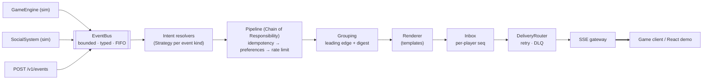

# GameNotify · Real-Time Notification System for a Gaming Platform

A small, production-shaped notification service. It takes **game events** (level up, rare item, challenge, PvP) and **social events** (friend request, friend accepted, new follower). For each event it decides who should be told, checks that player's **preferences**, writes a clear message, and pushes it **in real time** to the game client.

```
gameEngine.playerLeveledUp(1, 15)          → #1 Aria  [GAME/LEVEL_UP]         Congratulations! You've reached level 15!
gameEngine.itemAcquired(2, "SwordOfAzeroth") → #2 Bram  [GAME/ITEM_ACQUIRED]    You've acquired the legendary Sword of Azeroth!
socialSystem.friendRequestSent(3, 1)       → #1 Aria  [SOCIAL/FRIEND_REQUEST] Player 'Kael' has sent you a friend request.
socialSystem.friendRequestAccepted(1, 3)   → #3 Kael  [SOCIAL/FRIEND_ACCEPTED] Player 'Aria' accepted your friend request.
```

> **Stack:** TypeScript 7 · Node.js 24 LTS · Fastify 5 · Server-Sent Events · React 19 + Vite · Vitest + fast-check · pnpm workspaces · Docker · GitHub Actions. This matches GameNotify's published full-stack role (TypeScript / Node / React).

---

## Demo (2 min)

<p align="center">
  <a href="docs/media/demo.mp4">
    
  </a>
</p>

<p align="center"><b>▶ <a href="docs/media/demo.mp4">Watch the full-quality video (MP4, 1080p, 2 min 13 s)</a></b></p>

The recording shows the real server, SSE stream and React client running locally, driven by an automated browser:

1. **`pnpm demo`:** the brief's four example triggers and their exact messages.
2. **Two players, two browsers:** Aria and Kael sign in, and each opens a live Server-Sent Events stream.
3. **The brief's triggers, live:**
   - level up and a legendary item each produce a toast and an inbox entry
   - a common item is filtered out
   - Kael's friend request reaches Aria's screen in a few tens of milliseconds
   - Aria's acceptance notifies Kael
4. **Bursts, grouping and PvP:**
   - the first follower or attack is delivered instantly, and the rest of the burst becomes one digest
   - a defeat notifies both players
5. **Preferences:**
   - turning social events off means nothing is created
   - muting keeps notifications silently in the inbox, without a pop-up
   - read receipts sync with the server

For pacing, the recording runs the server with `GROUP_WINDOW_MS=6000`; the default grouping window is 10 s.

---

## Quick start

**Requirements:** Node.js ≥ 24 and pnpm 10. Run `corepack enable` first and pnpm comes from `packageManager` automatically.

No Node 24? Run `docker compose up --build` instead (needs only Docker). `pnpm install` refuses to run on older Node versions.

```bash
pnpm install
pnpm build          # compiles core + server + demo and bundles the web client
pnpm demo           # console walkthrough of the brief's example triggers (no HTTP)
pnpm start          # server + web client on http://localhost:3000
```

Open **http://localhost:3000** and pick a player (e.g. Aria). Open a **second tab** (or window) as another player (e.g. Kael). Use the *Simulate* panel: what one player does shows up as a live toast in the other tab, typically within tens of milliseconds.

**Docker:**

```bash
docker compose up --build      # http://localhost:3000
```

**Everything CI runs:**

```bash
pnpm verify   # lint → typecheck → tests (134) → architecture rules → build → golden demo check
pnpm bench    # performance budgets (p99 < 1 ms per event, ≥ 50k events/s)
pnpm load:sse # 2,000 live SSE connections @ 1,000 events/s; reports latency & RSS
```

---

## What's implemented

| Requirement (brief) | Where |
|---|---|
| In-game events: Level Up, Item Acquired (rare+ only), Challenge Completed, PvP attacked/defeated | `packages/core/src/application/resolvers/game-resolvers.ts` |
| Social events: Friend Request, Friend Accepted, New Follower | `…/resolvers/social-resolvers.ts` |
| In-app, real-time channel | SSE gateway: `apps/server/src/sse/*` |
| Clear, concise messages | `…/render/catalog-en.ts` (exact strings are unit-tested) |
| Per-user category preferences ("simple map") | `UserPreferences.categories` + `PreferenceStage` |
| `Notification` class | `packages/core/src/domain/notification.ts` (see assumption A1) |
| Receive events from different platform parts | `GameEngine` and `SocialSystem` publish to a typed in-process `EventBus`. Real producers use `POST /v1/events` |
| Dispatch: type → check prefs → create → send | `NotificationDispatcher` (`…/application/dispatcher.ts`) |
| Example usage | `pnpm demo` (golden-tested), plus the web simulator panel |

**Extras, built after the core passed its tests:**

- **Per-event-type overrides**, plus mute-for-N-minutes and quiet hours in the player's IANA time zone. HIGH-priority PvP attacks bypass quiet hours.
- **Offline inbox + replay.** Every notification is stored with a per-player `seq`. On reconnect the browser sends `Last-Event-ID` and the server replays exactly what was missed. After a restart or eviction the server sends an explicit `resync`.
- **Idempotency.** An event redelivered by an at-least-once producer notifies at most once.
- **Rate limiting.** A token bucket per player and category. Notifications over the limit are **stored silently, never dropped**.
- **Burst grouping.** The first follower or attack is delivered instantly. The rest of the burst collapses into *"Player 'Kael' and 3 others started following you."*
- **Ops:** Prometheus `/metrics`, `/healthz`, `/readyz`, structured logs, graceful shutdown, Docker health check.

---

## Architecture in one picture



- **Hexagonal core.** `packages/core` has **zero npm dependencies** and no HTTP or file I/O. Everything external (sender, clock, IDs, storage, logger, metrics) is a port. An architecture test fails the build if a layer boundary is crossed.
- **Reject early, render late.** Filters run on a cheap *intent*. Only surviving intents are rendered into a `Notification`. A suppressed event costs about **1.4 µs**, against **5.4 µs** for one that is fully rendered, stored and sent (`pnpm bench`).
- **Why SSE rather than WebSockets:** notifications only flow server → client. SSE gives automatic reconnect plus `Last-Event-ID` replay for free over plain HTTP (proxy- and HTTP/2-friendly). Client → server actions use REST. A WebSocket adapter would slot in behind the same `NotificationSender` port.

Full design: **[docs/HLD.md](docs/HLD.md)** (high level) · **[docs/LLD.md](docs/LLD.md)** (classes, algorithms, APIs, tests) · **[docs/adr/](docs/adr)** (decision records).

---

## Repository layout

```
packages/core/     domain · ports · application (bus, resolvers, pipeline, render, delivery) · in-memory adapters · simulators
apps/server/       Fastify host: SSE gateway, REST API, dev auth, Prometheus metrics, composition
apps/demo/         console demo of the brief's triggers (core only)
apps/web/          React 19 demo client (EventSource, inbox, preferences, simulator)
scripts/           bench.ts · load-sse.ts · check-golden.ts
docs/              HLD · LLD · ADRs · ai-process (how this was built with AI)
test/golden/       expected demo output (acceptance test)
```

---

## API (summary)

| Method | Path | Notes |
|---|---|---|
| `POST` | `/v1/dev/login` | `{ playerId }` → session cookie + bearer token (dev only) |
| `GET` | `/v1/stream` | SSE. Events: `hello`, `notification`, `resync`. Honours `Last-Event-ID` |
| `GET` | `/v1/notifications?before=&limit=` | Inbox page, newest first |
| `POST` | `/v1/notifications/:id/read` · `/v1/notifications/read-all` | Read receipts |
| `GET` / `PATCH` | `/v1/preferences` | JSON merge patch with `ETag` / `If-Match` (412 on conflict) |
| `POST` | `/v1/events` | Ingestion for real producers (`x-internal-key`). Returns 202, or 503 + `Retry-After` under back-pressure |
| `POST` | `/v1/dev/simulate` | `{ "action": "playerLeveledUp", "args": [1, 15] }`, mirroring the brief |
| `GET` | `/healthz` · `/readyz` · `/metrics` | Ops |

Errors use RFC 9457 Problem Details. Configuration is done with env vars (see `.env.example` and LLD §8).

---

## Assumptions (product gaps, confirmed before building)

| # | Decision |
|---|---|
| A1 | The brief says a `Notification` class is "provided", but it was **not included** in the PDF. We defined an immutable one (`domain/notification.ts`). |
| A2 | Only **RARE, EPIC and LEGENDARY** items notify ("rare or valuable"). Unknown items still notify, with a humanised name. |
| A3 | `friendRequestAccepted(1, 3)` notifies **player 3**, the original requester. |
| A4 | PvP: an attack notifies the victim. A defeat notifies **both** players (defeat and victory messages). PvP belongs to the Game category. |
| A5 | **Disabled** (category or type) means never created. **Muted, quiet hours or rate-limited** means stored silently in the inbox. |
| A6 | Grouping applies to followers and PvP attacks only. The first is delivered immediately, and the rest within 10 s become one digest. |

---

## Measured (this machine: 2-vCPU Xeon @ 2.1 GHz, Node 24.22)

| What | Result |
|---|---|
| `dispatcher.handle` (full path) | 5.4 µs avg · p99 ≈ 21 µs |
| Suppressed event (render skipped) | 1.4 µs avg |
| End-to-end through the bus | ≈ 128k events/s |
| SSE fan-out, 2k connections @ 1k events/s | p50 7 ms · p99 20 ms · RSS 195 MB |
| SSE fan-out, 10k connections @ 2k events/s | p50 9 ms · p99 27 ms · RSS 382 MB |
| Tests | 134 passing · core line coverage ≈ 98% |

For the SSE runs, the load client runs on the same machine, so latency includes client-side parsing.

---

## How this was built (AI-assisted)

The process is documented in **[docs/ai-process/](docs/ai-process/)**:

- The prompts that were used
- How requirements were extracted from the PDF and gaps resolved through clarifying questions
- The research behind each technology choice
- Where AI output was corrected (with real examples, such as a 6× performance bug found by profiling)
- How every change was verified with types, tests, architecture rules and benchmarks

`CLAUDE.md` holds the conventions every AI session followed.
