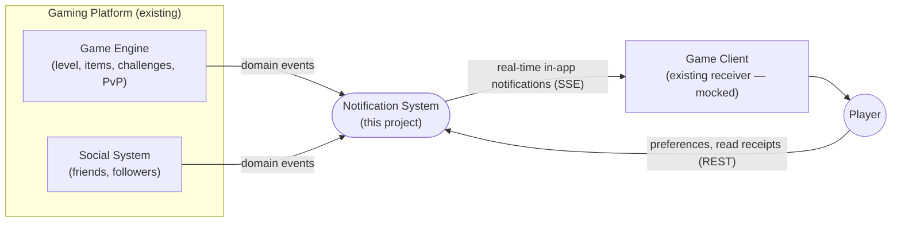
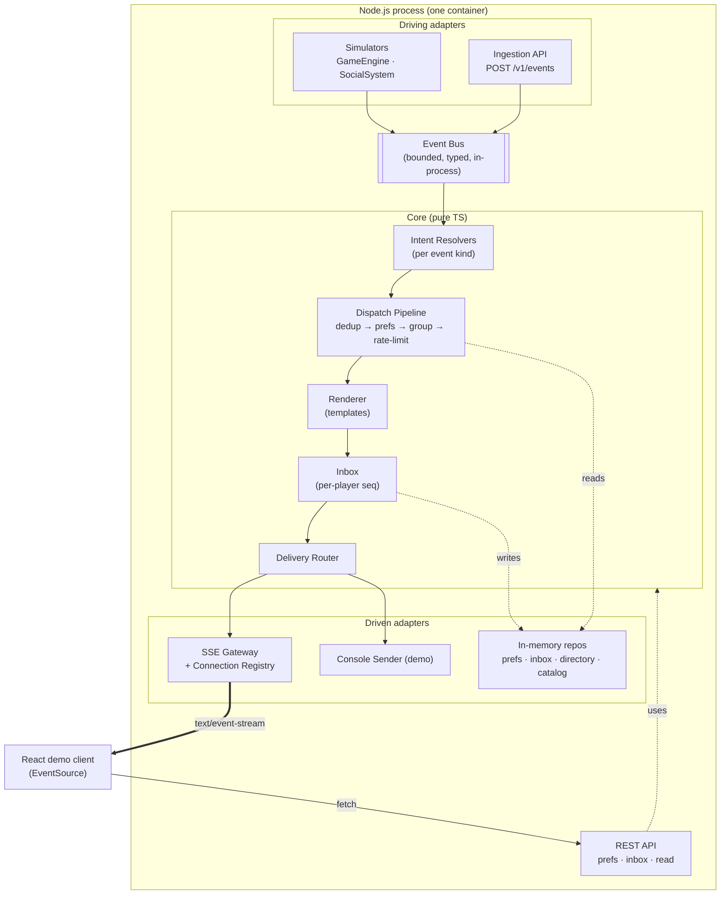
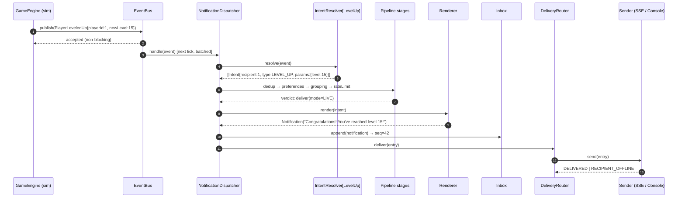
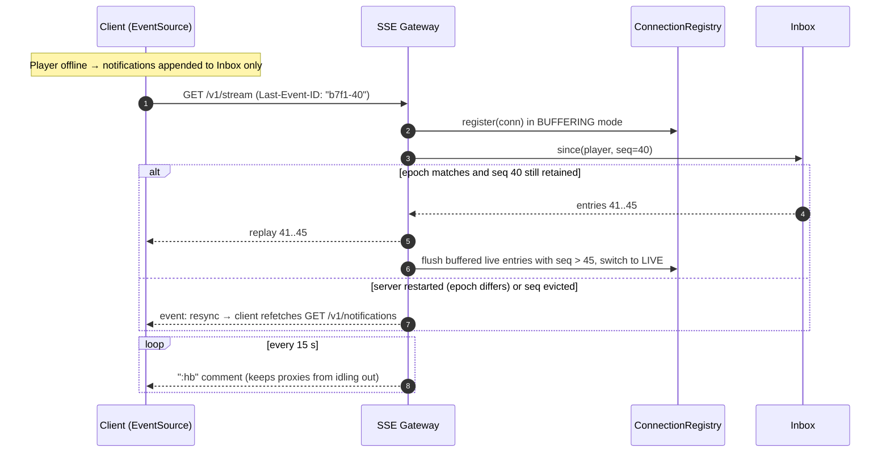
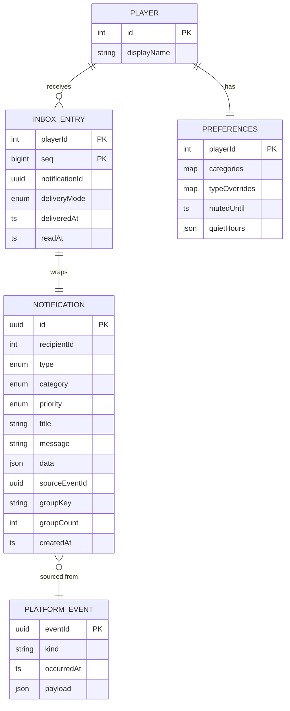
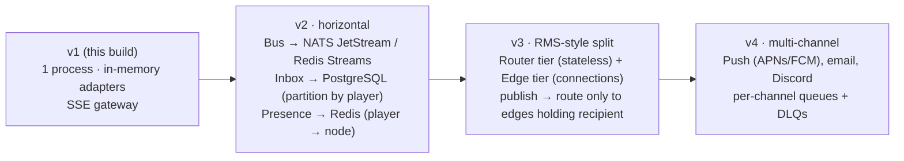

# High-Level Design — Real-Time Notification System for a Gaming Platform

| | |
|---|---|
| **Project** | GameNotify |
| **Document** | High-Level Design (HLD) |
| **Version** | 1.1 (as built). Implementation notes are in LLD §15 |
| **Author** | Sarthak Bhardwaj |
| **Date** | 18 Oct 2026 |
| **Status** | Implemented. Assumptions in §3 confirmed on 18 Oct 2026 |
| **Companion** | [`LLD.md`](./LLD.md): classes, algorithms, APIs, test plan |

---

## 1. Context

A multiplayer gaming platform emits **game events** (level up, item acquired, challenge completed, PvP) and **social events** (friend request, friend accepted, new follower). Players must be told about these **in real time and in-app**. Each player can switch notification categories on and off.

The brief asks us to focus on the core logic: **receive events → decide the notification type → build a `Notification` → check preferences → send**. Final rendering in the game client is out of scope. We mock it as an external dependency.

### 1.1 Goals

| # | Goal |
|---|---|
| G1 | Meet every functional requirement in the brief with clear, informative messages. |
| G2 | **Open/Closed growth.** A new event type, preference rule or delivery channel is added by *adding* a class and registering it. Existing code does not change. |
| G3 | Real-time delivery to connected players, plus **no lost notifications** for players who are offline or briefly disconnected. |
| G4 | Predictable low latency: under 1 ms p99 from event to send-call in process. Bounded memory under bursty load. |
| G5 | Runs with one command. Clean, tested, documented and easy to defend. |

### 1.2 Non-goals (v1)

- Push, email or SMS channels. They are designed for (a `DeliveryChannel` port) but not built.
- Durable multi-node storage. The in-memory adapters sit behind ports. The Postgres and Redis upgrade path is in §12.
- Production identity. A dev HMAC token stands in for OIDC/JWT; see §10.
- Rendering in the game client. A small React client exists only to *prove* the real-time path end to end.

---

## 2. Requirements

### 2.1 Functional (traced to the brief)

| ID | Requirement | Source |
|---|---|---|
| FR-1 | Level Up notification: *"Congratulations! You've reached level 15!"* | Brief, In-Game Events |
| FR-2 | Item Acquired notification, for **rare or valuable** items only: *"You've acquired the legendary Sword of Azeroth!"* | Brief |
| FR-3 | Challenge Completed notification | Brief |
| FR-4 | PvP Attacked / Defeated notifications | Brief, optional (chosen) |
| FR-5 | Friend Request: *"Player 'X' has sent you a friend request."* | Brief, Social Events |
| FR-6 | Friend Accepted notification to the original requester | Brief |
| FR-7 | New Follower notification | Brief |
| FR-8 | In-app, real-time channel only | Brief, Channels |
| FR-9 | Per-user enable/disable per **category** (Game, Social), held in a simple map | Brief, Preferences |
| FR-10 | Ingest events emitted by *different* platform parts (game engine, social system) | Brief, Event Handling |
| FR-11 | Dispatch pipeline: determine type → create `Notification` → check preferences → send | Brief, Dispatching |
| FR-12 | Runnable example that reproduces `gameEngine.playerLeveledUp(1, 15)`, `itemAcquired(2, "SwordOfAzeroth")`, `friendRequestSent(3, 1)`, `friendRequestAccepted(1, 3)` | Brief, Example Usage |
| FR-13 | Per-event-type overrides, mute-until and quiet hours | Extra (chosen) |
| FR-14 | Offline inbox, plus replay of missed notifications on reconnect | Extra (chosen) |
| FR-15 | Idempotent processing, per-user rate limiting, and grouping of bursts (*"Kael and 3 others started following you."*) | Extra (chosen) |
| FR-16 | Read/acknowledge a notification; unread count | Supports the inbox |

### 2.2 Non-functional

| ID | Quality | Target | How we verify |
|---|---|---|---|
| NFR-1 | Latency | Event → `send()` p99 **< 1 ms** in process (grouping windows excluded) | `mitata` micro-benchmark in CI |
| NFR-2 | Throughput | ≥ **50k events/s** on one core (recording sender, no network I/O) | Benchmark |
| NFR-3 | Fan-out | ≥ **10k** concurrent SSE connections per process, ≤ 400 MB RSS. Measured: 382 MB, p99 27 ms (initial 300 MB target missed and revised) | Load script (`scripts/load-sse.ts`) |
| NFR-4 | Bounded memory | Every queue, cache and buffer has a hard capacity and an overflow policy. The inbox is bounded by the per-player cap (200 entries) times the number of known players; ring buffers grow on demand up to that cap, so quiet players cost a few slots, not the full cap | Unit tests + code review checklist |
| NFR-5 | Reliability | At-least-once into the inbox. Duplicates suppressed by idempotency key. Per-recipient ordering preserved | Property tests (`fast-check`) |
| NFR-6 | Maintainability | Core has **zero** framework imports. Layer rules are enforced by tooling | Architecture test in CI (ADR-008) |
| NFR-7 | Testability | Time, IDs and I/O injected through ports. ≥ 90% line coverage on `core` | Vitest coverage gate |
| NFR-8 | Operability | Structured logs, Prometheus metrics, health endpoints, graceful shutdown | Integration tests |
| NFR-9 | Portability | `pnpm i && pnpm start` or `docker compose up` on macOS, Linux and WSL | CI matrix (Node 24, 26) |

---

## 3. Assumptions (confirmed)

The brief leaves these product points open. Each was raised as a clarifying question and **confirmed** before the build (see `docs/ai-process/process.md`).

| # | Topic | Assumption (default) |
|---|---|---|
| A1 | `Notification` class | The brief says it is "provided" but it is missing from the PDF. **We define it** (LLD §3.3) and say so in the README. |
| A2 | **Item rarity** | Only items at or above `RARE` notify (*"rare or valuable"*). The tiers are `COMMON < UNCOMMON < RARE < EPIC < LEGENDARY`, and the threshold is configurable. An item missing from the catalog notifies anyway, using a humanised name (`SwordOfAzeroth` → "Sword of Azeroth"), and increments a metric. This fails open for player experience. |
| A3 | Friend Accepted recipient | `friendRequestAccepted(1, 3)` notifies **player 3** (the requester): *"Player 'Aria' accepted your friend request."* Player 1 performed the action and gets nothing. |
| A4 | **PvP** | `playerAttacked(attackerId, victimId)` notifies the victim. `playerDefeated(winnerId, loserId)` notifies **both** sides with different messages. PvP falls under the **Game** category and can be muted per type. |
| A5 | Disabled vs. muted | **Disabled** (category or type off) means the notification is never created or stored. **Muted or quiet hours** means it is stored in the inbox but not pushed live. The player sees it the next time they open the inbox. |
| A6 | **Grouping** | Applies only to `NEW_FOLLOWER` and `PVP_ATTACKED`. The first event in a window is delivered **immediately** (leading edge). Later events within 10 s are collapsed into one follow-up: *"Kael and 3 others started following you."* Friend requests are never grouped because each one needs action. |
| A7 | Rate limit | 20 live notifications per player per category per minute, using a token bucket. Notifications over the limit are **downgraded to silent**: stored in the inbox, not dropped. The limiter runs after grouping, so events held for a digest spend no tokens; only what is emitted (the leading-edge notification and the digest) does. |
| A8 | Inbox retention | Each player keeps their last **200** notifications or **7 days**, whichever limit is hit first. A reconnect older than that window triggers a `resync`. |
| A9 | Player and item names | Player IDs are numeric, as in the brief. Display names come from a `PlayerDirectory` port, and item names and rarity come from an `ItemCatalog` port. Both are seeded in memory. |
| A10 | Defaults | New players have every category and type **enabled**, with no quiet hours. |

---

## 4. Architecture overview

### 4.1 Style

**Hexagonal (ports and adapters) + an event-driven, staged pipeline.**

- The **core** (domain + application) is pure TypeScript. It knows nothing about HTTP, SSE, the console or storage.
- **Driving adapters** feed events in. Examples: the simulated `GameEngine` and `SocialSystem`, and an internal `POST /v1/events` endpoint.
- **Driven adapters** carry results out: the SSE gateway, the console sender, and in-memory repositories.
- Inside the core, an **in-process event bus** decouples producers from the notification pipeline. Each pipeline stage is a small Chain-of-Responsibility step with one job.

Why this style: the project brief asks for *"flexibility and maintainability as the system grows"* and a clear approach to potential changes. Ports and adapters turn many "what if" scenarios into "add one adapter."

### 4.2 System context (C4 level 1)

### 4.3 Containers (C4 level 2)

### 4.4 Core flow (the brief's "dispatching notifications")

**Design note: check preferences before building the `Notification`.** The brief lists the steps as *create → check preferences → send*. We resolve a cheap **intent** first (recipient, type, params), apply every filter, and only then **render** the `Notification`. A notification that is going to be suppressed never pays for template rendering, directory lookups or allocation. The externally visible behaviour matches the brief.

### 4.5 Offline and reconnect flow

The connection is registered **before** reading the inbox, and live entries that arrive during replay are buffered and de-duplicated by `seq`. This closes the classic gap where an event lands between "read history" and "subscribe."

---

## 5. Component responsibilities

| Component | Pattern | Responsibility | Extension point |
|---|---|---|---|
| `GameEngine`, `SocialSystem` (simulators) | Facade / Producer | Expose the brief's exact API (`playerLeveledUp(1, 15)` …) and publish typed domain events | Real producers publish to the same bus, or call `POST /v1/events` |
| `EventBus` | Observer / Pub-Sub | Typed, bounded, non-blocking hand-off from producers to consumers. Isolates handler failures | Swap for NATS JetStream / Redis Streams (§12) |
| `IntentResolver` registry | **Strategy** + Registry | One resolver per event kind. Maps an event to 1..n `NotificationIntent`s (PvP defeat → 2 intents) | Add an event = add a resolver |
| Dispatch pipeline | **Chain of Responsibility** | Ordered, single-purpose stages: `Dedup → Preference → Grouping → RateLimit` | Insert a stage (e.g. A/B, spam score) without touching the others |
| `PreferencePolicy` | **Specification** | Combines category toggle, type override, mute-until and quiet hours into a verdict | New rule = new spec |
| `NotificationRenderer` | **Template Method** + message catalog | Turns an intent into an immutable `Notification` (title, message, data) | i18n: a locale-keyed catalog |
| `NotificationFactory` | **Factory** | The only place a `Notification` is constructed. Assigns ID (UUIDv7), timestamps, category and priority | — |
| `Inbox` | Repository | Per-player append-only log with monotonic `seq`. Replay, read state, retention | Postgres adapter |
| `DeliveryRouter` | **Strategy** (channels) + **Composite** | Routes an entry to every enabled channel. Retries with backoff. Dead-letters failures | Add push/email = add a `DeliveryChannel` |
| `ConnectionRegistry` | Registry | Player → live connections (multi-device). Presence | Redis presence for multi-node |
| SSE Gateway | Adapter | HTTP stream, heartbeat, back-pressure, Last-Event-ID replay | WebSocket adapter behind the same `ConnectionRegistry` |
| Composition root | Pure DI | Wires the object graph explicitly. No container, no decorators, no reflection | — |

---

## 6. Technology choices

Selected for a mainstream TypeScript, Node.js and React stack and current best practice as of Oct 2026.

| Concern | Choice | Why | Alternatives considered |
|---|---|---|---|
| Language | **TypeScript 7** (native `tsc`), `strict`, `erasableSyntaxOnly` | Matches the brief's camelCase API. TS 7 compiles about 10× faster. `erasableSyntaxOnly` keeps sources runnable by Node's built-in type stripping | TS 6.x (fallback if a tool breaks) |
| Runtime | **Node.js 24 LTS** (CI also on 26) | Active LTS today. Node 26 reaches LTS in late Oct 2026 | Bun (faster cold start, less proven in their stack) |
| HTTP | **Fastify 5** | About 2–3× Express throughput. Schema-compiled serialization. First-class TS types. Built-in `pino` | Express 5 (their stack; it is one adapter, so swapping is cheap) |
| Real-time transport | **Server-Sent Events** (hand-rolled on Fastify) | Notifications are server→client only. Native auto-reconnect and `Last-Event-ID` give replay for free. Plain HTTP, so it is proxy- and HTTP/2-friendly | WebSocket (`ws`/uWS) when bidirectional is needed; Socket.IO (heavier, ~20 KB client) |
| Validation | **JSON Schema** at the HTTP edge (Fastify + Ajv, unknown fields rejected). Precompiled **fast-json-stringify** for SSE frames | Zero extra dependencies. Ajv-compiled validators and serializers | TypeBox, Zod 4 |
| IDs | **UUIDv7** | Time-ordered, so it is index-friendly when the inbox moves to Postgres | ULID |
| Logging | **pino** | Fastest structured JSON logger in Node. Fastify default | — |
| Metrics | **prom-client** at `/metrics` | Prometheus/Grafana standard. Pairs with AWS-managed Prometheus | OpenTelemetry metrics SDK |
| Client | **React 19 + Vite** | Vite gives a tiny, fast demo. Next.js is unnecessary for one screen | Next.js |
| Monorepo | **pnpm workspaces** | Strict, fast, disk-efficient | npm workspaces, Turborepo (overkill here) |
| Lint/format | **Biome 2** | One fast tool. Does not depend on the TS compiler API, which matters because typescript-eslint is not yet compatible with TS 7 | ESLint + Prettier |
| Tests | **Vitest**, **fast-check**, an in-repo **architecture test**, **mitata**, Playwright (scripted browser check) | Unit and integration, property-based, layering rules (dependency-cruiser can't read TS 7 yet, see ADR-008), micro-benchmarks | Jest, dependency-cruiser |
| Delivery | **Docker** (multi-stage, `node:24-slim`, non-root, health check), **GitHub Actions** | One command to run | Distroless (smaller, harder to debug) |
| In-process dispatch | **Hand-written typed bus** | MediatR-style libraries add indirection with no benefit at this size. The bus is about 80 lines and fully typed | Node `EventEmitter` (synchronous, untyped, no back-pressure) |

---

## 7. Data model (logical)

- **Preferences** follow the brief's "simple dictionary or map": `categories: { GAME: true, SOCIAL: false }`, with optional `typeOverrides: { PVP_ATTACKED: false }`.
- **`seq`** is a per-player monotonic integer and acts as the SSE event id. Combined with a server **epoch**, it makes replay exact and detects restarts.

---

## 8. Delivery semantics and reliability

| Property | Guarantee | Mechanism |
|---|---|---|
| Ingestion | Non-blocking; explicit rejection when full | Bounded ring-buffer bus. `publish()` returns `accepted` or `rejected` |
| Duplicates | At most one notification per `(eventId, recipient, type)` | TTL-bounded LRU idempotency store (10 min, 100k keys) |
| Storage | At-least-once into the inbox | Append happens before any delivery attempt |
| Live delivery | Best effort, recoverable | Missed live pushes are replayed from the inbox using `Last-Event-ID` |
| Ordering | Per-recipient FIFO | Single-threaded event loop plus monotonic per-player `seq`. The client dedups by `seq` |
| Failure isolation | One bad handler or channel cannot stall others | Per-handler try/catch, retry with exponential backoff and full jitter (3×), then a dead-letter queue with metrics |
| Slow consumers | Never block the dispatcher | Per-connection outbound buffer cap (1,000 frames). Past the cap, the connection is closed and the client replays on reconnect. Notifications are **disconnected and replayed, never silently dropped** |
| Shutdown | Graceful | Stop intake → drain bus → flush grouping windows → close streams with a `retry:` hint → exit |

---

## 9. Performance strategy

Node runs JavaScript on one thread. The work is to **keep the event loop free**, **allocate little**, and **serialize once**.

1. **Batch drain with yield.** The bus drains up to 512 events per macrotask (`setImmediate`), then yields, so socket I/O and timers stay responsive under bursts.
2. **Reject early, render late.** Filters run on light intents. Templates and lookups run only for survivors (§4.4).
3. **O(1) hot-path lookups.** Preferences, connections, rate buckets and dedup all use `Map`. Message templates are precompiled functions, not string parsing.
4. **Serialize once per notification.** The SSE frame (`id/event/data`) is built once and written to each of the player's connections.
5. **Write coalescing.** Frames for a socket are batched within a tick using `cork()` / `uncork()`, which means fewer syscalls.
6. **Few timers.** There is one heartbeat interval per process, not one per connection. The rate limiter refills tokens lazily and uses no timers. Grouping windows use lazily re-armed, `unref()`'d timeouts, so extending a window never touches `clearTimeout`.
7. **Back-pressure aware writes.** The return value of `socket.write()` and `'drain'` are honoured. The buffer is bounded (§8).
8. **No sync I/O, no `JSON.parse` on the hot path**, and lazy logging (`pino` level guards).
9. **Measured, not assumed.** `mitata` benchmarks with budgets fail CI on regression. The SSE load script reports p50/p99 and RSS.

**Measured results (v1.0, 2-vCPU Xeon @ 2.1 GHz, Node 24.22):**

| Metric | Result |
|---|---|
| Full path, per event | 5.4 µs avg, p99 ≈ 21 µs |
| Suppressed path (render skipped) | 1.4 µs |
| End to end through the bus | ≈ 128k events/s |
| 2k SSE connections @ 1k events/s | p50 7 ms, p99 20 ms, 195 MB RSS |
| 10k SSE connections @ 2k events/s | p50 9 ms, p99 27 ms, 382 MB RSS |

The first build ran at 76 µs per event. Profiling found V8 Map tombstones in the dedup store; ADR-010 has the fix.

---

## 10. Security and privacy

- **AuthN for the stream.** `EventSource` cannot send headers, so the demo uses an HMAC-signed, short-lived token (`/v1/dev/login`) delivered as an **HttpOnly SameSite cookie**. Production would use OIDC/JWT from the platform's identity provider.
- **AuthZ.** A player can only stream and read their **own** inbox. The player ID comes from the token, never from the URL.
- **Input validation.** Every external payload is validated with JSON Schema (Ajv), and unknown fields are rejected.
- **Output safety.** Messages are plain text. Interpolated names are length-capped and control-character-stripped. The client renders text nodes, never HTML.
- **Abuse controls.** Rate limiting per player/category (A7). Ingestion is bounded (§8). Optional `@fastify/rate-limit` on REST.
- **Headers.** Security headers are set in an `onSend` hook: CSP, `nosniff`, `X-Frame-Options: DENY` and `Referrer-Policy`. The web client is served from the same origin, so CORS is not needed. Streams send `Cache-Control: no-store`.
- **PII.** Only player IDs and display names are stored. Notifications expire with inbox retention (A8), which supports GDPR-style minimisation.

---

## 11. Observability

| Signal | Detail |
|---|---|
| Logs | `pino` JSON with `eventId`, `notificationId`, `playerId`, `stage`, `verdict`, `latencyUs`. Correlates event → notification → delivery |
| Metrics | `events_received_total{kind}`, `notifications_suppressed_total{reason}`, `notifications_delivered_total{channel,result}`, `dispatch_latency_seconds` (histogram), `bus_queue_depth`, `sse_connections`, `dlq_size` |
| Health | `/healthz` (liveness), `/readyz` (bus accepting, not draining) |
| Tracing (future) | OpenTelemetry spans per stage. Context propagated from `eventId` |

---

## 12. Scalability and evolution path

v1 is deliberately single-process, as the brief asks. Some of the steps below are adapter swaps. Others need real design work, listed after the diagram.

- **v2.** Producers publish to a durable stream. Dispatcher workers form a consumer group partitioned by `recipientId`, which keeps per-player ordering. Gateways subscribe to a per-node channel. Presence lives in Redis with TTL heartbeats.
- **v3.** Mirrors **Riot Messaging Service**: stateless routing, edge nodes that only hold sockets, and durable sessions that cache in memory across short disconnects. Riot reports about 10M connections per edge node in testing.
- **Bandwidth.** At scale, send deltas instead of snapshots and use stream compression. Discord cut gateway traffic by about 40% with zstd streaming plus delta updates.

**What is an adapter swap, and what is not.**

- *Adapter swaps (no core change):* new delivery channels (`DeliveryChannel`, `NotificationSender`: push, email, WebSocket), logging and metrics sinks, the clock, scheduler and id generator, and the player directory and content catalog (both are read-only lookups today).
- *Needs real work:*
  - **Storage.** `PreferenceRepository`, `InboxRepository` and `IdempotencyStore` are **synchronous** ports (`packages/core/src/ports/index.ts`), and the dispatcher is synchronous by design (LLD §5.2). A Postgres or Redis adapter needs async ports, or a write-behind/outbox pattern that keeps the in-memory hot path and persists behind it.
  - **Sharding.** Dispatchers must be partitioned by player id so one node owns each player's state.
  - **Process-local state.** Grouping timers, rate-limit token buckets, the idempotency cache and per-player sequence numbers live in process memory. They must be externalised or pinned to the owning shard, and sequence allocation must stay monotonic per player across restarts and failover.
  - **Bus.** The in-process bus gives back-pressure and ordering for free. A durable stream has to preserve per-player ordering and define redelivery, which the idempotency store then absorbs.

---

## 13. Testing strategy

| Layer | Tooling | What |
|---|---|---|
| Unit | Vitest | Every resolver, stage, policy, renderer string, and the inbox and bus |
| Property | fast-check | Dedup idempotence, per-player ordering, grouping conservation (n events in → counts sum to n), rate-limit bound |
| Contract | Vitest shared suites | One test suite run against **every** adapter of a port (in-memory now, Postgres later) |
| Integration | Fastify `inject` + real `EventSource` client | SSE handshake, replay, resync, heartbeat, back-pressure eviction, auth |
| E2E / acceptance | Demo script snapshot | The brief's four triggers produce the exact expected messages |
| Architecture | `architecture.test.ts` (static import scan) | Layer matrix, zero npm deps in core, no cycles, apps use the public API only |
| Performance | mitata, SSE load script | NFR-1..3 budgets enforced in CI (bench job) |

---

## 14. Delivery plan

| Milestone | Scope | Exit criteria |
|---|---|---|
| M0 · Sun 18 | Specs: HLD, LLD, ADRs, repo scaffold, CI | `pnpm test` green on an empty skeleton |
| M1 · Mon 19 AM | **Core MVP**: bus, resolvers (FR-1..7), preferences (FR-9), renderer, console sender, demo (FR-12) | Brief acceptance test passes |
| M2 · Mon 19 PM | SSE gateway, inbox + replay, REST, React client | Live demo in browser; replay test passes |
| M3 · Tue 20 AM | Extras: type overrides, quiet hours, dedup, rate limit, grouping | Property tests pass |
| M4 · Tue 20 PM | Docker, README, AI-process write-up, benchmarks, final polish | Fresh-clone run verified |

The core is built first and is always shippable, so if time runs short, extras are cut from the end of the list.

---

## 15. Architecture decision records (summary)

| ADR | Decision | Key trade-off |
|---|---|---|
| 001 | TypeScript / Node 24, mainstream, well-supported stack | Single thread → we design for non-blocking I/O, not CPU parallelism |
| 002 | Hexagonal core + in-process typed bus | Small indirection cost; large gain in testability and extensibility |
| 003 | SSE over WebSocket for the live channel | No client→server messages on the stream (we use REST for those) in exchange for free reconnect and replay |
| 004 | Preference check before rendering ("intent first") | Two-step model (intent → notification) in exchange for less wasted work |
| 005 | Per-player `seq` + epoch as the SSE id | Requires a resync path after a restart, but gives exact replay |
| 006 | Leading-edge grouping | Two messages instead of one for bursts, but the first notification is never delayed |
| 007 | Disconnect slow consumers instead of dropping frames | Reconnect cost in exchange for no silent loss |
| 008 | No DI container or mediator library | Manual wiring (about 60 lines) in exchange for zero magic and fast startup |
| 009 | In-memory adapters behind ports in v1 | Not durable across restarts (handled by resync), but matches the brief's "simple map" |
| 010 | Hot-path data structures chosen by profiling | Ring-buffer eviction instead of Map head-iteration (V8 tombstones). 76 µs → 5.4 µs per event |

Full ADRs live in [`docs/adr/`](./adr/).

---

## 16. Readiness for "what-if" scenarios

| Scenario | Change required |
|---|---|
| Add a new event type (e.g. *Guild Invite*) | Add the event to `domain/events.ts` and `ALL_EVENT_KINDS`, a `TYPE_META` row, an `EN_CATALOG` template, an `IntentResolver` registered in `composition.ts`, an `event(...)` entry in `apps/server/src/http/schemas.ts`, and tests. About six small edits in existing files, no changes to the dispatcher or pipeline. The compiler and boot-time `assertComplete` catch everything except `schemas.ts`. |
| Add push or email | Implement `DeliveryChannel`, register it in the router, and add `channels` to preferences |
| 1M concurrent players | v2/v3 path (§12): stream bus, partitioned dispatchers, edge gateways, Redis presence |
| Localisation | The message catalog is already keyed. Add a locale to preferences and per-locale templates (ICU MessageFormat) |
| Priority / urgent bypass | `Priority.HIGH` skips quiet hours and the rate limit. This is one rule in the policy |
| Digest emails | A scheduled consumer reads unread inbox entries older than N hours |
| Exactly-once? | Not achievable end to end over networks. We use at-least-once with idempotency, and say so |
| Replace SSE with WebSocket | Add a `ws` gateway beside `SseConnection` and `ConnectionRegistry`, implementing the same `NotificationSender` port. The core is unchanged |
| Multi-region | Region-local edges. Route by home region. The inbox is replicated asynchronously |

---

## 17. AI-assisted development process

The process is captured **in the repo** under `docs/ai-process/`:

1. **Requirements extraction.** The PDF was parsed and turned into the traceable FR/NFR tables above.
2. **Research.** Prior art (Riot RMS, Xbox RTA, Discord gateway), transport trade-offs (.NET/Node SSE vs WebSocket), library status (TS 7, Node LTS, MediatR licensing). Sources are listed in `docs/ai-process/research.md`.
3. **Clarification loop.** Gaps were raised as explicit questions (missing `Notification` class, stack, scope, extras) and resolved before design.
4. **Spec-driven build.** HLD → LLD → ADRs → tests-first per component. Each AI session is anchored by `CLAUDE.md` (conventions, layer rules, commands).
5. **Prompt log.** Key prompts, what was accepted or rejected, and why, in `docs/ai-process/prompts.md`.
6. **Verification.** AI output is gated by types, tests, architecture rules and benchmarks, never by trust alone.

---

### References

- Riot Games: *Riot Messaging Service*, technology.riotgames.com/node/58
- Discord: *How Discord reduced WebSocket traffic by 40%*, discord.com/blog
- Microsoft: *Xbox Real-Time Activity service overview*, learn.microsoft.com/gaming
- KodeKloud: *Notification System: bottlenecks and the real world* (idempotency, DLQ, per-channel queues)
- snarfed.org: *Clustering notifications*
- InfoQ: *TypeScript 7 released* (Aug 2026)
