# Low-Level Design — Real-Time Notification System

| | |
|---|---|
| **Document** | Low-Level Design (LLD) |
| **Version** | 1.1 (as built). Deviations from the baseline are listed in §15 |
| **Author** | Sarthak Bhardwaj |
| **Date** | 18 Oct 2026 |
| **Parent** | [`HLD.md`](./HLD.md). Requirement IDs (FR/NFR) and assumptions (A1–A10) are defined there |

---

## 1. Repository layout

```
gamenotify/
├─ packages/
│  └─ core/                         # zero runtime dependencies, framework-free
│     └─ src/
│        ├─ domain/                 # entities, value objects, enums, events (pure)
│        │  ├─ ids.ts               # branded IDs
│        │  ├─ notification.ts      # Notification class + NotificationFactory
│        │  ├─ notification-type.ts # NotificationType, Category, Priority, TYPE_META
│        │  ├─ events.ts            # PlatformEvent discriminated union
│        │  ├─ intent.ts            # NotificationIntent
│        │  ├─ preferences.ts       # UserPreferences + defaults
│        │  ├─ inbox-entry.ts
│        │  └─ result.ts            # Result<T,E>, SuppressionReason
│        ├─ ports/                  # interfaces the core depends on (driven) or exposes (driving)
│        ├─ application/
│        │  ├─ bus/                 # InProcessEventBus, RingBuffer
│        │  ├─ resolvers/           # one IntentResolver per event kind (Strategy)
│        │  ├─ pipeline/            # stages: idempotency, preference, grouping, rate-limit
│        │  ├─ render/              # NotificationRenderer + message catalog
│        │  ├─ delivery/            # DeliveryRouter, retry, DLQ
│        │  ├─ dispatcher.ts        # NotificationDispatcher (orchestrator)
│        │  └─ services/            # PreferenceService, InboxService (use cases for REST)
│        ├─ infrastructure/memory/  # in-memory adapters (dependency-free)
│        ├─ simulation/             # GameEngine, SocialSystem (brief's API)
│        └─ index.ts                # public surface
├─ apps/
│  ├─ server/                       # Fastify: SSE gateway, REST, auth, metrics, composition root
│  ├─ demo/                         # console demo (core + memory adapters only, no HTTP)
│  └─ web/                          # React 19 + Vite demo client
├─ docs/  HLD.md  LLD.md  adr/  ai-process/
├─ scripts/ load-sse.ts  bench.ts
├─ .github/workflows/ci.yml
├─ test/golden/demo.txt            # acceptance golden file
├─ Dockerfile  docker-compose.yml  CLAUDE.md  README.md
└─ pnpm-workspace.yaml  tsconfig.base.json  tsconfig.test.json  biome.json  vitest.config.ts
```

**Layer rules** (enforced by `packages/core/test/architecture.test.ts`, ADR-008):

| From → To | domain | ports | application | infrastructure | simulation | apps/* |
|---|---|---|---|---|---|---|
| **domain** | ✓ | ✗ | ✗ | ✗ | ✗ | ✗ |
| **ports** | ✓ | ✓ | ✗ | ✗ | ✗ | ✗ |
| **application** | ✓ | ✓ | ✓ | ✗ | ✗ | ✗ |
| **infrastructure** | ✓ | ✓ | ✗ | ✓ | ✗ | ✗ |
| **simulation** | ✓ | ✓ | ✗ | ✗ | ✓ | ✗ |
| **apps** | ✓ | ✓ | ✓ | ✓ | ✓ | own only |

In addition, `packages/core` may not import `node:http`, `fastify`, `react` or any npm package.

---

## 2. Coding conventions

- **TypeScript 7**, `strict`, `exactOptionalPropertyTypes`, `noUncheckedIndexedAccess`, `verbatimModuleSyntax`, **`erasableSyntaxOnly`**. That means no `enum`, `namespace` or constructor parameter properties, so every file can also run under Node's native type stripping (`node --watch src/main.ts` in dev).
- ESM only. Relative imports use the `.ts` extension, and `rewriteRelativeImportExtensions` rewrites them on emit.
- Enumerations are `as const` objects plus a derived union type.
- Domain objects are **immutable** (`readonly` fields, `Object.freeze` in factories).
- Expected failures are values (`Result<T, E>`). Exceptions are reserved for programmer errors and I/O faults.
- Time and randomness are **always injected** (`Clock`, `IdGenerator`). Nothing in `core` calls `Date.now()` or `crypto` directly.
- Naming: interfaces describe roles (`NotificationSender`). Implementations describe mechanism (`SseNotificationSender`, `InMemoryInbox`).
- Lint and format: Biome 2. Commit style: Conventional Commits.

---

## 3. Domain model

### 3.1 Branded identifiers — `domain/ids.ts`

```ts
declare const brand: unique symbol;
export type Brand<T, B extends string> = T & { readonly [brand]: B };

export type PlayerId       = Brand<number, 'PlayerId'>;
export type EventId        = Brand<string, 'EventId'>;        // UUIDv7
export type NotificationId = Brand<string, 'NotificationId'>; // UUIDv7
export type ItemId         = Brand<string, 'ItemId'>;         // e.g. "SwordOfAzeroth"
export type ChallengeId    = Brand<string, 'ChallengeId'>;

export const PlayerId = (n: number): PlayerId => {
  if (!Number.isSafeInteger(n) || n <= 0) throw new RangeError(`invalid PlayerId ${n}`);
  return n as PlayerId;
};
```

Branding stops a `PlayerId` from being passed where an `ItemId` is expected, at zero runtime cost.

### 3.2 Types, categories, priorities — `domain/notification-type.ts`

```ts
export const NotificationCategory = { GAME: 'GAME', SOCIAL: 'SOCIAL' } as const;
export type NotificationCategory = (typeof NotificationCategory)[keyof typeof NotificationCategory];

export const NotificationType = {
  LEVEL_UP: 'LEVEL_UP',
  ITEM_ACQUIRED: 'ITEM_ACQUIRED',
  CHALLENGE_COMPLETED: 'CHALLENGE_COMPLETED',
  PVP_ATTACKED: 'PVP_ATTACKED',
  PVP_DEFEATED: 'PVP_DEFEATED',
  PVP_VICTORY: 'PVP_VICTORY',
  FRIEND_REQUEST: 'FRIEND_REQUEST',
  FRIEND_ACCEPTED: 'FRIEND_ACCEPTED',
  NEW_FOLLOWER: 'NEW_FOLLOWER',
} as const;
export type NotificationType = (typeof NotificationType)[keyof typeof NotificationType];

export const Priority = { LOW: 0, NORMAL: 1, HIGH: 2 } as const;
export type Priority = (typeof Priority)[keyof typeof Priority];

export const DeliveryMode = { LIVE: 'LIVE', SILENT: 'SILENT' } as const;
export type DeliveryMode = (typeof DeliveryMode)[keyof typeof DeliveryMode];

export const ItemRarity = { COMMON: 0, UNCOMMON: 1, RARE: 2, EPIC: 3, LEGENDARY: 4 } as const;
export type ItemRarity = (typeof ItemRarity)[keyof typeof ItemRarity];

/** Single source of truth for per-type behaviour. Adding a type = one row here. */
export interface TypeMeta {
  readonly category: NotificationCategory;
  readonly priority: Priority;
  readonly groupable: boolean;   // eligible for burst grouping (A6)
}

export const TYPE_META = Object.freeze({
  LEVEL_UP:            { category: 'GAME',   priority: Priority.NORMAL, groupable: false },
  ITEM_ACQUIRED:       { category: 'GAME',   priority: Priority.NORMAL, groupable: false },
  CHALLENGE_COMPLETED: { category: 'GAME',   priority: Priority.NORMAL, groupable: false },
  PVP_ATTACKED:        { category: 'GAME',   priority: Priority.HIGH,   groupable: true  },
  PVP_DEFEATED:        { category: 'GAME',   priority: Priority.NORMAL, groupable: false },
  PVP_VICTORY:         { category: 'GAME',   priority: Priority.NORMAL, groupable: false },
  FRIEND_REQUEST:      { category: 'SOCIAL', priority: Priority.NORMAL, groupable: false },
  FRIEND_ACCEPTED:     { category: 'SOCIAL', priority: Priority.NORMAL, groupable: false },
  NEW_FOLLOWER:        { category: 'SOCIAL', priority: Priority.LOW,    groupable: true  },
} as const satisfies Record<NotificationType, TypeMeta>);
```

The `satisfies Record<NotificationType, TypeMeta>` clause turns a **missing row into a compile error** when a new type is added.

### 3.3 `Notification` — `domain/notification.ts` (A1)

The brief says this class is "provided." Since it was not, this is our definition: immutable, serializable, and channel-agnostic.

```ts
export type JsonValue = string | number | boolean | null | JsonValue[] | { [k: string]: JsonValue };

export interface NotificationProps {
  readonly recipientId: PlayerId;
  readonly type: NotificationType;
  readonly title: string;                       // short headline, e.g. "Level Up!"
  readonly message: string;                     // human text, e.g. "Congratulations! You've reached level 15!"
  readonly data: Readonly<Record<string, JsonValue>>; // structured params for client deep-links/icons
  readonly sourceEventId: EventId;
  readonly groupKey?: string;
  readonly groupCount?: number;                 // 1 unless aggregated
}

export class Notification {
  readonly id: NotificationId;
  readonly recipientId: PlayerId;
  readonly type: NotificationType;
  readonly category: NotificationCategory;
  readonly priority: Priority;
  readonly title: string;
  readonly message: string;
  readonly data: Readonly<Record<string, JsonValue>>;
  readonly sourceEventId: EventId;
  readonly groupKey: string | null;
  readonly groupCount: number;
  readonly createdAt: number;                   // epoch ms (cheaper than Date on the hot path)

  private constructor(id: NotificationId, createdAt: number, p: NotificationProps) {
    const meta = TYPE_META[p.type];
    this.id = id;
    this.recipientId = p.recipientId;
    this.type = p.type;
    this.category = meta.category;
    this.priority = meta.priority;
    this.title = p.title;
    this.message = p.message;
    this.data = p.data;
    this.sourceEventId = p.sourceEventId;
    this.groupKey = p.groupKey ?? null;
    this.groupCount = p.groupCount ?? 1;
    this.createdAt = createdAt;
    Object.freeze(this);
  }

  /** Only NotificationFactory calls this (enforced by lint rule + module boundary). */
  static create(id: NotificationId, createdAt: number, props: NotificationProps): Notification {
    if (props.message.length === 0 || props.message.length > 280) throw new RangeError('message length');
    return new Notification(id, createdAt, props);
  }

  toJSON(): NotificationDto { /* plain object; ISO timestamp */ }
}

export class NotificationFactory {
  readonly #ids: IdGenerator;
  readonly #clock: Clock;
  constructor(ids: IdGenerator, clock: Clock) { this.#ids = ids; this.#clock = clock; } // no parameter properties (erasableSyntaxOnly)
  create(props: NotificationProps): Notification {
    return Notification.create(this.#ids.notificationId(), this.#clock.now(), props);
  }
}
```

### 3.4 Platform events — `domain/events.ts`

A discriminated union on `kind`. Every event carries an `eventId` (the idempotency key) and `occurredAt`.

```ts
interface EventBase { readonly eventId: EventId; readonly occurredAt: number }

export type PlatformEvent =
  | (EventBase & { kind: 'game.player_leveled_up';   playerId: PlayerId; newLevel: number })
  | (EventBase & { kind: 'game.item_acquired';       playerId: PlayerId; itemId: ItemId })
  | (EventBase & { kind: 'game.challenge_completed'; playerId: PlayerId; challengeId: ChallengeId })
  | (EventBase & { kind: 'game.pvp_attacked';        attackerId: PlayerId; victimId: PlayerId })
  | (EventBase & { kind: 'game.pvp_defeated';        winnerId: PlayerId; loserId: PlayerId })
  | (EventBase & { kind: 'social.friend_request_sent';     senderId: PlayerId; recipientId: PlayerId })
  | (EventBase & { kind: 'social.friend_request_accepted'; accepterId: PlayerId; requesterId: PlayerId })
  | (EventBase & { kind: 'social.player_followed';         followerId: PlayerId; followeeId: PlayerId });

export type EventKind = PlatformEvent['kind'];
export type EventOf<K extends EventKind> = Extract<PlatformEvent, { kind: K }>;
```

### 3.5 Intent — `domain/intent.ts`

A lightweight "would notify" record. It is produced by resolvers and filtered **before** rendering (HLD §4.4).

```ts
export interface NotificationIntent {
  readonly recipientId: PlayerId;
  readonly type: NotificationType;
  readonly params: Readonly<Record<string, JsonValue>>; // e.g. { level: 15 } | { actorId: 3 }
  readonly sourceEventId: EventId;
  readonly occurredAt: number;
  readonly groupKey?: string;          // set by resolver when TYPE_META.groupable
  readonly groupCount?: number;        // set by grouping stage on flush
  readonly actorIds?: readonly PlayerId[]; // set by grouping stage on flush (first ≤3)
}
```

### 3.6 Preferences — `domain/preferences.ts`

This is the brief's "simple dictionary or map," extended per FR-13.

```ts
export interface QuietHours {
  readonly start: `${number}:${number}`;   // "22:00"
  readonly end:   `${number}:${number}`;   // "07:00" (may wrap past midnight)
  readonly timeZone: string;               // IANA, e.g. "Asia/Kolkata"
}

export interface UserPreferences {
  readonly playerId: PlayerId;
  readonly categories: Readonly<Record<NotificationCategory, boolean>>;     // { GAME: true, SOCIAL: true }
  readonly typeOverrides: Readonly<Partial<Record<NotificationType, boolean>>>;
  readonly mutedUntil: number | null;      // epoch ms
  readonly quietHours: QuietHours | null;
  readonly version: number;                // optimistic concurrency for PUT/PATCH
}

export const defaultPreferences = (playerId: PlayerId): UserPreferences => Object.freeze({
  playerId, categories: { GAME: true, SOCIAL: true }, typeOverrides: {},
  mutedUntil: null, quietHours: null, version: 0,
});
```

### 3.7 Inbox entry — `domain/inbox-entry.ts`

```ts
export interface InboxEntry {
  readonly seq: number;                // per-player, strictly increasing, starts at 1
  readonly notification: Notification;
  readonly mode: DeliveryMode;         // LIVE | SILENT
  deliveredAt: number | null;          // mutated only by InboxService
  readAt: number | null;               // mutated only by InboxService
}
```

> Implementation note: `deliveredAt` and `readAt` are the only mutable fields, and only `InboxService` changes them. Everything else is frozen.

### 3.8 Results and suppression reasons — `domain/result.ts`

```ts
export type Result<T, E> = { readonly ok: true; readonly value: T } | { readonly ok: false; readonly error: E };

export const SuppressionReason = {
  DUPLICATE: 'DUPLICATE',
  TYPE_DISABLED: 'TYPE_DISABLED',
  CATEGORY_DISABLED: 'CATEGORY_DISABLED',
  BELOW_RARITY_THRESHOLD: 'BELOW_RARITY_THRESHOLD',
  SELF_ACTION: 'SELF_ACTION',        // e.g. player follows themselves
  GROUPED: 'GROUPED',                // held for a trailing group notification
  UNKNOWN_RECIPIENT: 'UNKNOWN_RECIPIENT',
} as const;
export type SuppressionReason = (typeof SuppressionReason)[keyof typeof SuppressionReason];
```

---

## 4. Ports — `packages/core/src/ports/`

```ts
// ── Cross-cutting ───────────────────────────────────────────────
export interface Clock { now(): number }                                   // epoch ms
export interface IdGenerator { eventId(): EventId; notificationId(): NotificationId } // UUIDv7
export interface Scheduler {                                               // testable timers
  setTimeout(fn: () => void, ms: number): { cancel(): void };
}
export interface Logger { debug(o: object, m?: string): void; info(...): void; warn(...): void; error(...): void }
export interface Metrics {
  inc(name: MetricName, labels?: Labels, by?: number): void;
  observe(name: HistogramName, value: number, labels?: Labels): void;
  gauge(name: GaugeName, value: number, labels?: Labels): void;
}

// ── Event ingestion (driving) ───────────────────────────────────
export type PublishResult = 'accepted' | 'rejected';
export interface EventPublisher { publish(event: PlatformEvent): PublishResult }
export interface EventSubscriber {
  subscribe<K extends EventKind>(kind: K, handler: (e: EventOf<K>) => Promise<void>): () => void;
  subscribeAll(handler: (e: PlatformEvent) => Promise<void>): () => void;
}
export interface EventBus extends EventPublisher, EventSubscriber {
  readonly depth: number;
  drain(): Promise<void>;   // resolves when queue empty (shutdown, tests)
}

// ── Reference data (driven) ─────────────────────────────────────
export interface PlayerDirectory { displayName(id: PlayerId): string | undefined; exists(id: PlayerId): boolean }
export interface ContentCatalog {
  item(id: ItemId): { name: string; rarity: ItemRarity } | undefined;
  challenge(id: ChallengeId): { name: string } | undefined;
}

// ── State (driven) ──────────────────────────────────────────────
export interface PreferenceRepository {
  get(id: PlayerId): UserPreferences;                       // returns defaults if absent
  put(prefs: UserPreferences, expectedVersion: number): Result<UserPreferences, 'VERSION_CONFLICT'>;
}
export type SinceResult =
  | { kind: 'entries'; entries: readonly InboxEntry[] }
  | { kind: 'resync'; oldestSeq: number };
export interface InboxRepository {
  append(n: Notification, mode: DeliveryMode): InboxEntry;   // assigns seq
  since(player: PlayerId, afterSeq: number, limit: number): SinceResult;
  page(player: PlayerId, beforeSeq: number | null, limit: number): readonly InboxEntry[];
  markRead(player: PlayerId, id: NotificationId, at: number): boolean;
  markAllRead(player: PlayerId, upToSeq: number, at: number): number;
  unreadCount(player: PlayerId): number;
  readonly epoch: string;                                    // changes on restart (HLD ADR-005)
}
export interface IdempotencyStore { firstSeen(key: string): boolean }   // true = new, records it

// ── Delivery (driven) — the brief's "existing notification client" ─
export type DeliveryResult = 'DELIVERED' | 'RECIPIENT_OFFLINE' | 'FAILED';
export interface NotificationSender {
  readonly name: string;
  send(entry: InboxEntry): Promise<DeliveryResult>;
}
export interface DeliveryChannel {               // future: push, email
  readonly name: 'in_app' | (string & {});
  accepts(entry: InboxEntry, prefs: UserPreferences): boolean;
  send(entry: InboxEntry): Promise<DeliveryResult>;
}
export interface DeadLetterQueue { put(item: DeadLetter): void; list(limit: number): readonly DeadLetter[]; readonly size: number }

// ── Presence (driven) ───────────────────────────────────────────
export interface PresenceQuery { isOnline(player: PlayerId): boolean; onlineCount(): number }
```

---

## 5. Application layer

### 5.1 `InProcessEventBus` — `application/bus/`

**Goals:** non-blocking `publish`, bounded memory, typed subscriptions, failure isolation, and fairness with I/O.

```ts
export class InProcessEventBus implements EventBus {
  #queue: RingBuffer<PlatformEvent>;            // fixed capacity, power of two (default 65_536)
  #byKind = new Map<EventKind, Handler[]>();    // copy-on-write arrays → safe iteration
  #all: Handler[] = [];
  #scheduled = false;
  #batch: number;                               // default 512
  ...
  publish(e: PlatformEvent): PublishResult {
    if (!this.#queue.push(e)) { this.metrics.inc('bus_rejected_total', { kind: e.kind }); return 'rejected'; }
    if (!this.#scheduled) { this.#scheduled = true; setImmediate(this.#drainTick); }
    return 'accepted';
  }

  #drainTick = async () => {
    let n = 0;
    while (n < this.#batch) {
      const e = this.#queue.shift(); if (e === undefined) break;
      n++;
      const hs = this.#byKind.get(e.kind) ?? EMPTY;
      // Handlers for the same event run concurrently; events are processed in order.
      await Promise.allSettled([...hs, ...this.#all].map(h => this.#invoke(h, e)));
    }
    this.metrics.gauge('bus_queue_depth', this.#queue.size);
    if (this.#queue.size > 0) setImmediate(this.#drainTick);  // yield to I/O, then continue
    else { this.#scheduled = false; this.#resolveDrainWaiters(); }
  };

  async #invoke(h: Handler, e: PlatformEvent) {
    try { await h(e); }
    catch (err) { this.log.error({ err, eventId: e.eventId, kind: e.kind }, 'handler failed');
                  this.metrics.inc('bus_handler_errors_total', { kind: e.kind }); }
  }
}
```

**`RingBuffer<T>`.** A preallocated array with head and tail indices and a `mask = capacity - 1`, so `push` and `shift` are O(1) with no allocations. `shift` clears the slot to help the GC.

**Why awaiting per event inside a batch?** It preserves **global FIFO**, which in turn preserves per-recipient ordering (NFR-5), while still amortising scheduling over 512 events. Handlers in this design are CPU-bound and microsecond-scale. I/O (socket writes) is fire-and-forget at the sender, so awaiting does not stall the loop on network.

**Rejected alternative:** `EventEmitter`. It is synchronous (the producer pays the consumer's cost), untyped, has no back-pressure, and a throwing listener propagates into the producer.

### 5.2 `NotificationDispatcher` — `application/dispatcher.ts`

The orchestrator. It subscribes to the bus once (`subscribeAll`) and runs the pipeline.

```ts
export class NotificationDispatcher {
  constructor(deps: {
    resolvers: ResolverRegistry; pre: PipelineStage[]; post: PipelineStage[]; digest: PipelineStage[]; grouping: GroupingStage;
    renderer: NotificationRenderer; inbox: InboxRepository; delivery: DeliveryRouter;
    prefs: PreferenceRepository; clock: Clock; metrics: Metrics; log: Logger;
  }) { ... }

  start(bus: EventSubscriber): () => void {
    this.grouping.onFlush((intent, mode) => this.#emitDigest(intent, mode)); // trailing group path
    return bus.subscribeAll(e => this.handle(e));
  }

  async handle(event: PlatformEvent): Promise<void> {
    const t0 = performance.now();
    this.metrics.inc('events_received_total', { kind: event.kind });
    const intents = this.resolvers.resolve(event);                 // Strategy lookup, O(1)
    for (const intent of intents) {
      const ctx: StageContext = { intent, prefs: this.prefs.get(intent.recipientId),
                                  mode: DeliveryMode.LIVE, now: this.clock.now() };
      const verdict = runStages(this.pre, ctx);                    // see 5.4
      if (verdict.kind === 'suppress') { this.#suppressed(intent, verdict.reason); continue; }
      const g = this.grouping.offer(ctx);                          // leading-edge pass or hold
      if (g === 'held') { this.#suppressed(intent, 'GROUPED'); continue; }
      runStages(this.post, ctx);                                   // rate limit: only what is emitted spends tokens
      await this.#finish(intent, ctx.mode);
    }
    this.metrics.observe('dispatch_latency_seconds', (performance.now() - t0) / 1e3);
  }

  #emitDigest(intent: NotificationIntent, mode: DeliveryMode): void {      // trailing group path
    const ctx: StageContext = { intent, prefs: this.prefs.get(intent.recipientId), mode, now: this.clock.now() };
    const verdict = runStages(this.digest, ctx);                   // preferences again: they may have changed during the window
    if (verdict.kind === 'suppress') { this.#suppressed(intent, verdict.reason); return; }
    runStages(this.post, ctx);                                     // rate limit
    this.#finish(intent, ctx.mode);
  }

  #finish(intent: NotificationIntent, mode: DeliveryMode): void {
    const notification = this.renderer.render(intent);              // render late
    const entry = this.inbox.append(notification, mode);            // at-least-once store, seq assigned
    if (mode === DeliveryMode.LIVE) this.#inflight.track(this.delivery.deliver(entry)); // NOT awaited
  }
}
```

**Why delivery is not awaited.** If the dispatcher awaited delivery, one sender retrying with backoff (up to about 2 s) would stall the bus for **every** player. Instead:

- The first send attempt runs synchronously up to its first `await`. The SSE sender writes to the socket synchronously, so frames still leave in `seq` order.
- Retries run in the background. A retried frame can arrive out of order, so the client orders by `seq` and dedups by notification `id` (LLD §6.6).
- `#inflight` is a `Set<Promise>`. Graceful shutdown awaits it after `bus.drain()` so no delivery attempt is abandoned.

### 5.3 Intent resolvers (Strategy + registry) — `application/resolvers/`

```ts
export interface IntentResolver<K extends EventKind = EventKind> {
  readonly kind: K;
  resolve(e: EventOf<K>): readonly NotificationIntent[];
}

export class ResolverRegistry {
  #map = new Map<EventKind, IntentResolver>();
  register<K extends EventKind>(r: IntentResolver<K>): this {
    if (this.#map.has(r.kind)) throw new Error(`duplicate resolver ${r.kind}`);
    this.#map.set(r.kind, r as IntentResolver); return this;
  }
  resolve(e: PlatformEvent): readonly NotificationIntent[] {
    const r = this.#map.get(e.kind);
    return r ? r.resolve(e as never) : (this.log.warn({ kind: e.kind }, 'no resolver'), EMPTY);
  }
  assertComplete(kinds: readonly EventKind[]): void { /* startup check: every kind has a resolver */ }
}
```

| Resolver | Event | Intents produced | Rule notes |
|---|---|---|---|
| `LevelUpResolver` | `game.player_leveled_up` | `LEVEL_UP → playerId` `{level}` | `newLevel` must be a positive integer |
| `ItemAcquiredResolver` | `game.item_acquired` | `ITEM_ACQUIRED → playerId` `{itemId}` | **Rarity gate (A2):** skipped if `catalog.item(id).rarity < MIN_ITEM_RARITY`. Unknown item → allowed, metric `catalog_miss_total` |
| `ChallengeCompletedResolver` | `game.challenge_completed` | `CHALLENGE_COMPLETED → playerId` `{challengeId}` | — |
| `PvpAttackedResolver` | `game.pvp_attacked` | `PVP_ATTACKED → victimId` `{actorId: attackerId}`, `groupKey = pvp:atk:{victim}` | Self-attack → none |
| `PvpDefeatedResolver` | `game.pvp_defeated` | `PVP_DEFEATED → loserId {actorId: winner}` **and** `PVP_VICTORY → winnerId {actorId: loser}` | Fan-out to 2 (A4) |
| `FriendRequestResolver` | `social.friend_request_sent` | `FRIEND_REQUEST → recipientId` `{actorId: senderId}` | Self → none |
| `FriendAcceptedResolver` | `social.friend_request_accepted` | `FRIEND_ACCEPTED → requesterId` `{actorId: accepterId}` | A3 |
| `NewFollowerResolver` | `social.player_followed` | `NEW_FOLLOWER → followeeId` `{actorId: followerId}`, `groupKey = follow:{followee}` | Self → none |

The rarity gate sits in the resolver, not the preference stage. It is a **product rule about the event** ("only rare items are notification-worthy"), not a user choice.

### 5.4 Pipeline stages (Chain of Responsibility)

Idempotency and preferences run before grouping (`pre`). The rate limiter runs after it (`post`), so events that grouping holds back never consume tokens. Only the leading-edge intent and each digest do.

A digest is emitted up to `Wmax` after its events were held, so the dispatcher re-evaluates preferences (`digest` stages) and then the rate limit when it flushes. A category or type disabled during the window means the digest is never created. A mute or quiet hours starting during the window stores it as SILENT.

```ts
export type Verdict = { kind: 'continue' } | { kind: 'suppress'; reason: SuppressionReason };
export interface StageContext { readonly intent: NotificationIntent; readonly prefs: UserPreferences;
                                mode: DeliveryMode; readonly now: number }
export interface PipelineStage { readonly name: string; apply(ctx: StageContext): Verdict }

export const runStages = (stages: readonly PipelineStage[], ctx: StageContext): Verdict => {
  for (const s of stages) { const v = s.apply(ctx); if (v.kind === 'suppress') return v; }
  return CONTINUE;
};
```

The stages are **synchronous and allocation-free** on the happy path. `CONTINUE` is a shared frozen constant. Order (cheapest and most selective first): `Idempotency → Preference → Grouping → RateLimit`.

#### 5.4.1 `IdempotencyStage`

- Key: `${sourceEventId}|${recipientId}|${type}`.
- `IdempotencyStore.firstSeen(key)` returns `false` → `suppress(DUPLICATE)`.
- `TtlLruIdempotencyStore`: a `Map<string, expiresAt>` for lookup plus a `RingBuffer<{key, expiresAt}>` recording insertion order. Because the TTL is uniform, insertion order equals expiry order. On every insert:
  1. Pop the ring head while it has expired.
  2. Pop it while `size >= maxKeys`.

  Both steps are O(1), with no timers.
  - A popped slot deletes its Map key only if the Map still holds that same `expiresAt`, so re-inserted keys survive.
  - *As built:* the first version iterated the Map from its head. V8 tombstones made that O(n), measured at 70% of CPU (ADR-010).
  - The defaults are a 10 min TTL and 100k keys, about 12 MB worst case.

#### 5.4.2 `PreferenceStage` (Specification)

The evaluation order is **most specific first**:

```
1. o = prefs.typeOverrides[type]
   o === false                       → suppress(TYPE_DISABLED)
   o === true                        → enabled (skips step 2)
2. prefs.categories[category] false  → suppress(CATEGORY_DISABLED)
3. prefs.mutedUntil > now            → ctx.mode = SILENT
4. quietHours active(now, tz) AND priority < HIGH → ctx.mode = SILENT
5. continue
```

Quiet-hours computation:

```ts
const fmtCache = new Map<string, Intl.DateTimeFormat>();   // Intl formatter creation is expensive → cache per tz
function localMinutes(now: number, tz: string): number {
  let f = fmtCache.get(tz);
  if (!f) { f = new Intl.DateTimeFormat('en-GB', { timeZone: tz, hour: '2-digit', minute: '2-digit', hourCycle: 'h23' }); fmtCache.set(tz, f); }
  const parts = f.formatToParts(now);           // [{type:'hour'},{type:'minute'}]
  return Number(parts[0]!.value) * 60 + Number(parts[2]!.value);
}
const inWindow = (m: number, s: number, e: number) => s <= e ? (m >= s && m < e) : (m >= s || m < e); // wraps midnight
```

The time zone is validated when preferences are saved, using `Intl.supportedValuesOf('timeZone')`.

#### 5.4.3 `RateLimitStage` (token bucket, A7)

- The bucket key is `${playerId}|${category}`. The state is `{ tokens: number; last: number }` in a `Map`.
- `take(now)`:
  - `tokens = min(cap, tokens + (now - last) * refillPerMs)`, then set `last = now`.
  - If `tokens >= 1`, decrement and return ok.
- On deny: set `ctx.mode = SILENT` (never drop) and increment `rate_limited_total{category}`.
- Applies only when `ctx.mode === LIVE` and `priority < HIGH`.
- Runs after grouping. Held events are never offered to it, so a burst of 25 followers costs 1 token (leading edge) plus 1 (digest), not 25.
- Memory bound: FIFO eviction through a ring of keys, capped at 200k buckets. There is no LRU touch on hit, which avoids Map delete/re-insert churn. An evicted bucket simply restarts full, which only ever errs towards delivering.

### 5.5 `GroupingStage` (leading-edge + trailing collapse, A6)

States per `groupKey`:

```mermaid
stateDiagram-v2
  [*] --> Idle
  Idle --> Open: offer(intent) / pass through immediately (leading edge), arm timer(W)
  Open --> Open: offer(intent) / hold: count++, keep ≤3 actorIds, windowEnd=min(now+W, openedAt+Wmax)
  Open --> Idle: timer fires & now ≥ windowEnd / flush (count==0 → nothing; count==1 → single; count>1 → aggregated)
  Open --> Open: timer fires & now < windowEnd / re-arm for (windowEnd − now)
```



```ts
interface Group { openedAt: number; windowEnd: number; held: number; actors: PlayerId[];
                  last: NotificationIntent | null; silent: boolean }

offer(ctx: StageContext): 'pass' | 'held' {
  const { intent } = ctx;
  if (!intent.groupKey) return 'pass';
  const g = this.#groups.get(intent.groupKey);
  if (!g) {                                                  // leading edge
    this.#groups.set(intent.groupKey, { openedAt: ctx.now, windowEnd: ctx.now + this.W, held: 0, actors: [], last: null, silent: false });
    this.#arm(intent.groupKey, this.W);
    return 'pass';
  }
  g.held++; g.last = intent;
  if (g.actors.length < 3) g.actors.push(intent.params.actorId as PlayerId);
  g.windowEnd = Math.min(ctx.now + this.W, g.openedAt + this.Wmax);   // sliding, capped
  if (ctx.mode === DeliveryMode.SILENT) g.silent = true;              // any silent member → silent digest
  return 'held';
}

#arm(key: string, ms: number) {
  this.scheduler.setTimeout(() => {
    const g = this.#groups.get(key); if (!g) return;
    const now = this.clock.now();
    if (now < g.windowEnd) return this.#arm(key, g.windowEnd - now);  // lazy re-arm, no clearTimeout churn
    this.#groups.delete(key);
    if (g.held === 0) return;
    const out = g.held === 1 ? g.last!
      : { ...g.last!, actorIds: g.actors, groupCount: g.held, sourceEventId: g.last!.sourceEventId };
    this.#flush(out, g.silent ? DeliveryMode.SILENT : DeliveryMode.LIVE); // → dispatcher.#finish
  }, ms);
}
```

- **Defaults:** `W = 10 s`, `Wmax = 60 s`. The demo uses `W = 1.5 s` so the effect is visible.
- **Conservation property** (fast-check): for any sequence of `n` offers on one key, `passed + Σ groupCount(flushed) = n`.
- **Shutdown:** `flushAll()` emits every open group synchronously before the process exits.

### 5.6 Renderer and message catalog — `application/render/`

The renderer is a Template Method: a fixed skeleton (resolve names → pick template → build `data`) with a per-type template function.

```ts
type Template = (p: RenderInput) => { title: string; message: string };
interface RenderInput { intent: NotificationIntent; name: (id: PlayerId) => string; catalog: ContentCatalog }

export const EN_CATALOG = {
  LEVEL_UP:            ({ intent }) => ({ title: 'Level Up!', message: `Congratulations! You've reached level ${intent.params.level}!` }),
  ITEM_ACQUIRED:       ({ intent, catalog }) => { const it = itemView(intent.params.itemId, catalog);
                         return { title: `${it.rarityLabel} Item Acquired`.trim(), message: `You've acquired the ${it.prefix}${it.name}!` }; },
  CHALLENGE_COMPLETED: ({ intent, catalog }) => ({ title: 'Challenge Completed',
                         message: `Challenge complete! You've conquered '${challengeName(intent, catalog)}'.` }),
  PVP_ATTACKED:        (p) => ({ title: 'Under Attack!', message: `You're under attack by ${actors(p)}!` }),
  PVP_DEFEATED:        (p) => ({ title: 'Defeated',      message: `You were defeated by Player '${p.name(actor(p))}'.` }),
  PVP_VICTORY:         (p) => ({ title: 'Victory!',      message: `You defeated Player '${p.name(actor(p))}'!` }),
  FRIEND_REQUEST:      (p) => ({ title: 'Friend Request', message: `Player '${p.name(actor(p))}' has sent you a friend request.` }),
  FRIEND_ACCEPTED:     (p) => ({ title: 'Friend Request Accepted', message: `Player '${p.name(actor(p))}' accepted your friend request.` }),
  NEW_FOLLOWER:        (p) => ({ title: 'New Follower', message: `${actors(p)} started following you.` }),
} as const satisfies Record<NotificationType, Template>;

// actors(): 1 → "Player 'Kael'"; n>1 → "Player 'Kael' and 3 others"; n=2 → "Player 'Kael' and 1 other"
```

| Type | Example output (exact strings, used by the acceptance tests) |
|---|---|
| LEVEL_UP | `Congratulations! You've reached level 15!` |
| ITEM_ACQUIRED | `You've acquired the legendary Sword of Azeroth!` |
| CHALLENGE_COMPLETED | `Challenge complete! You've conquered 'Dragon's Lair'.` |
| PVP_ATTACKED | `You're under attack by Player 'Zed'!` Grouped, one attacker who also sent the delivered first attack: `Player 'Zed' attacked you 3 more times!`. Grouped, one attacker who is new: `Player 'Kael' attacked you 3 times!` Grouped, several attackers: `You're under attack by Player 'Zed' and 2 others!` |
| PVP_DEFEATED / VICTORY | `You were defeated by Player 'Zed'.` / `You defeated Player 'Mira'!` |
| FRIEND_REQUEST | `Player 'Kael' has sent you a friend request.` |
| FRIEND_ACCEPTED | `Player 'Aria' accepted your friend request.` |
| NEW_FOLLOWER | `Player 'Kael' started following you.`, or grouped: `Player 'Mira' and 3 others started following you.` |

- **Name safety:** `name(id)` returns the directory display name, with control characters stripped and the length capped at 32. Unknown IDs render as `Player #<id>`.
- **Unknown item (A2):** `"SwordOfAzeroth"` is humanised with `/(?<=[a-z])(?=[A-Z])/` → "Sword of Azeroth" (articles lower-cased), with no rarity prefix.
- **`data` payload:** `{ level }`, `{ itemId, rarity }`, `{ actorIds }` and so on, so the client can render icons and deep links without parsing text.
- **i18n path:** the catalog is selected by `prefs.locale` (future). The catalog's type forces every type to be translated.

### 5.7 Inbox — `infrastructure/memory/in-memory-inbox.ts`

```ts
interface PlayerLog { firstSeq: number; nextSeq: number; ring: (InboxEntry | undefined)[]; head: number; size: number;
                      byId: Map<NotificationId, InboxEntry>; unread: number }
```

- **`append`** is O(1). `seq = nextSeq++`. Write `ring[(head + size) % cap]`. When full, drop the oldest (advance `head` and `firstSeq`, delete it from `byId`, and adjust `unread`).
- **`since(after, limit)`:**
  - If `after < firstSeq - 1`, return `resync`.
  - Otherwise `start = after - firstSeq + 1`, and slicing is O(k) because the seqs are **contiguous**, so no search is needed.
- **TTL (7 d):** expired entries are pruned lazily from the head on each `append`/`since` call, and by an hourly `unref()`'d sweep.
- **`epoch`:** 8 hex characters from `crypto.randomUUID()` at construction. Used as the SSE id prefix `"{epoch}-{seq}"`.
- **Memory:** 200 entries × about 0.5 KB × 100k players ≈ 10 GB, which is why HLD v2 moves the inbox to Postgres. v1 targets the demo and tests.

### 5.8 Delivery — `application/delivery/`

```ts
export class DeliveryRouter {
  readonly #d: DeliveryRouterDeps;   // { channels, retry, dlq, prefs, clock, metrics, sleep }
  constructor(deps: DeliveryRouterDeps) { this.#d = deps; }
  async deliver(entry: InboxEntry): Promise<void> {
    const prefs = this.#d.prefs.get(entry.notification.recipientId);
    await Promise.all(this.#d.channels.filter(c => c.accepts(entry, prefs)).map(c => this.#withRetry(c, entry)));
  }
  async #withRetry(c: DeliveryChannel, e: InboxEntry): Promise<void> {
    for (let attempt = 1; ; attempt++) {
      let r: DeliveryResult;
      try { r = await c.send(e); } catch { r = 'FAILED'; }
      this.metrics.inc('notifications_delivered_total', { channel: c.name, result: r });
      if (r !== 'FAILED') return;                                // DELIVERED or RECIPIENT_OFFLINE (inbox has it)
      if (attempt >= this.retry.maxAttempts) return this.dlq.put({ entry: e, channel: c.name, attempts: attempt, at: this.clock.now() });
      await sleep(this.retry.delay(attempt));                    // full jitter: random(0, min(cap, base·2^attempt))
    }
  }
}
```

- `InAppChannel` adapts the `NotificationSender` port (the brief's "existing notification client"). It accepts every entry in v1.
- `RECIPIENT_OFFLINE` is **not a failure**. The entry is already in the inbox and will be replayed.
- Retries never block other recipients or the bus, because the dispatcher does not await delivery (§5.2). Retries only happen on exceptions, which are rare.
- `RetryPolicy` defaults: `maxAttempts 3`, `base 50 ms`, `cap 2 s`. `InMemoryDeadLetterQueue` is a ring buffer of 1,000 entries.

---

## 6. Adapters

### 6.1 Simulators: the brief's API — `core/src/simulation/`

These reproduce the brief's calls **verbatim** and publish typed events. They depend only on `EventPublisher`, `IdGenerator` and `Clock`.

```ts
export class GameEngine {
  readonly #bus: EventPublisher; readonly #ids: IdGenerator; readonly #clock: Clock;
  constructor(bus: EventPublisher, ids: IdGenerator, clock: Clock) { this.#bus = bus; this.#ids = ids; this.#clock = clock; }

  playerLeveledUp(playerId: number, newLevel: number): PublishResult {
    return this.#emit({ kind: 'game.player_leveled_up', playerId: PlayerId(playerId), newLevel });
  }
  itemAcquired(playerId: number, itemId: string): PublishResult { ... }            // 'game.item_acquired'
  challengeCompleted(playerId: number, challengeId: string): PublishResult { ... }  // 'game.challenge_completed'
  playerAttacked(attackerId: number, victimId: number): PublishResult { ... }       // 'game.pvp_attacked'
  playerDefeated(winnerId: number, loserId: number): PublishResult { ... }          // 'game.pvp_defeated'

  #emit<E extends DistributiveOmit<PlatformEvent, 'eventId' | 'occurredAt'>>(e: E): PublishResult {
    return this.#bus.publish({ ...e, eventId: this.#ids.eventId(), occurredAt: this.#clock.now() } as PlatformEvent);
  }
}

export class SocialSystem {
  friendRequestSent(senderId: number, recipientId: number): PublishResult { ... }     // 'social.friend_request_sent'
  friendRequestAccepted(accepterId: number, requesterId: number): PublishResult { ... } // 'social.friend_request_accepted'
  playerFollowed(followerId: number, followeeId: number): PublishResult { ... }        // 'social.player_followed'
}
```

Argument semantics follow the brief's comments exactly:

- `friendRequestSent(3, 1)`: user 3 sends to user 1.
- `friendRequestAccepted(1, 3)`: user 1 accepts the request from 3.

**Seed data** (`infrastructure/memory/seed.ts`):

- **Players:** 1 Aria, 2 Bram, 3 Kael, 4 Mira, 5 Zed, 6 Nyx.
- **Items:**
  - `SwordOfAzeroth` (LEGENDARY)
  - `DragonboneBow` (EPIC)
  - `MoonstoneAmulet` (RARE)
  - `RustyDagger` (COMMON)
- **Challenges:** `DragonsLair` ("Dragon's Lair"), `HundredWins` ("Centurion").

### 6.2 `ConsoleNotificationSender` (demo) — `core/src/infrastructure/console/`

It prints an aligned, colourised line through an injected `write` function (so the core never touches `process.stdout`) and returns `DELIVERED`:

```
→ #1 Aria   [GAME/LEVEL_UP]         Congratulations! You've reached level 15!
```

Colours are disabled when `NO_COLOR` is set or stdout is not a TTY, which keeps CI output stable for the golden-file test.

### 6.3 SSE gateway — `apps/server/src/sse/`

**Components:**

- `SseConnection` wraps `ServerResponse`.
- `ConnectionRegistry` maps `PlayerId → Set<SseConnection>` and implements `PresenceQuery`.
- `SseNotificationSender` implements `NotificationSender`.
- `HeartbeatTicker` keeps idle connections alive.

**Route `GET /v1/stream`:**

```
1. auth: playerId ← verify cookie `gid` (HMAC, §6.5); 401 otherwise
2. reply.hijack(); res.writeHead(200, {
     'Content-Type': 'text/event-stream; charset=utf-8',
     'Cache-Control': 'no-store', 'Connection': 'keep-alive',
     'X-Accel-Buffering': 'no' })                     // disable nginx/ALB buffering
   res.socket.setNoDelay(true); res.socket.setKeepAlive(true, 30_000)
3. write("retry: 3000\n\n")                            // client reconnect delay
4. conn = registry.add(playerId, res, state=BUFFERING) // evict oldest if > MAX_CONN_PER_PLAYER (5)
5. cursor = parse(Last-Event-ID header ?? query.lastEventId)   // "epoch-seq"
   if cursor && cursor.epoch === inbox.epoch:
       r = inbox.since(playerId, cursor.seq, REPLAY_LIMIT=500)
       if r.kind === 'resync' → send(event:'resync', data:{reason:'evicted'})
       else for e in r.entries → conn.write(frame(e)); conn.lastSeq = e.seq
   else if cursor (epoch mismatch) → send(event:'resync', data:{reason:'restart'})
   else → send(event:'hello', data:{epoch, unread})       // first connect: client fetches page
6. conn.goLive(): flush conn.pending where seq > conn.lastSeq; state = LIVE
7. res.on('close') → registry.remove(conn)
```

**Race-free handoff.** Between steps 4 and 6, `SseNotificationSender.send()` sees `state === BUFFERING` and pushes into `conn.pending` instead of writing. Step 6 discards anything with `seq ≤ lastSeq` that the replay already covered. Every entry is therefore delivered **exactly once per connection, in seq order**.

**Frame format** (built once per entry and reused across the player's connections):

```
id: 3fa9c2d1-42
event: notification
data: {"seq":42,"silent":false,"notification":{"id":"0192…","type":"LEVEL_UP","category":"GAME",…}}

```

- `data` is produced by a **precompiled `fast-json-stringify` serializer** generated from the frame's JSON Schema. It is about 2–5× faster than `JSON.stringify` for a fixed shape.
- Frames are cached per entry (`WeakMap<InboxEntry, string>`) so multi-device fan-out serializes once.

**Writing with back-pressure:**

```ts
write(frame: string): void {
  if (this.state === 'BUFFERING') { this.pending.push(frame); return; }
  if (this.queue.length > 0 || this.res.writableNeedDrain) {          // socket buffer full
    if (this.queue.length >= MAX_BUFFERED_FRAMES) return this.evict('slow_consumer'); // close; client replays
    this.queue.push(frame); return;
  }
  if (!this.corked) { this.res.cork(); this.corked = true; process.nextTick(this.#uncork); } // coalesce a tick's frames
  this.res.write(frame);
}
// res.on('drain') → write queued frames until writableNeedDrain again
```

**Heartbeat.** A single `setInterval(15 s).unref()` iterates the registry and writes `:\n\n` only to connections idle for at least 15 s. That stays under the common 30–60 s proxy idle timeouts.

**`SseNotificationSender.send(entry)`:**

- `conns = registry.get(recipientId)`. If there are none, return `RECIPIENT_OFFLINE`.
- Otherwise build the frame once, then `conns.forEach(c => c.write(frame))`, set `entry.deliveredAt = now`, and return `DELIVERED`.

It is synchronous apart from the `Promise` wrapper, which is what keeps live delivery ordered (§5.2).

### 6.4 REST API — `apps/server/src/http/`

All routes validate requests with JSON Schema (Ajv, `removeAdditional: false`, so unknown fields are rejected) and return `application/json`. Errors follow **RFC 9457 Problem Details**.

| Method & path | Auth | Request | Response | Notes |
|---|---|---|---|---|
| `POST /v1/dev/login` | none (dev only) | `{ playerId }` | `204` + `Set-Cookie: gid` | Disabled when `NODE_ENV=production` |
| `GET /v1/me` | cookie | — | `{ playerId, displayName, unread }` | |
| `GET /v1/stream` | cookie | `Last-Event-ID` | `text/event-stream` | §6.3 |
| `GET /v1/notifications` | cookie | `?before=<seq>&limit=1..100` (default 50) | `{ epoch, entries[], nextBefore, unread }` | Newest first |
| `POST /v1/notifications/:id/read` | cookie | — | `204` / `404` | Idempotent |
| `POST /v1/notifications/read-all` | cookie | `{ upToSeq }` | `{ marked }` | |
| `GET /v1/preferences` | cookie | — | `UserPreferences` + `ETag: "v{version}"` | |
| `PATCH /v1/preferences` | cookie | JSON Merge Patch (RFC 7396) + `If-Match` | `200` / `412` on version conflict | Validates time zone and types |
| `POST /v1/events` | `x-internal-key` | `PlatformEvent` (`eventId` optional → generated) | `202` / `503` + `Retry-After: 1` when bus full | Ingestion for real producers |
| `POST /v1/dev/simulate` | none (dev only) | `{ action: "playerLeveledUp", args: [1, 15], repeat? }` | `202` | Calls `GameEngine`/`SocialSystem` with the brief's exact signatures; drives the web demo |
| `GET /v1/players` | none | — | seeded players | For the demo's player picker |
| `GET /v1/admin/dlq` | `x-internal-key` | `?limit` | `DeadLetter[]` | |
| `GET /healthz` · `/readyz` · `/metrics` | none | — | `200` / Prometheus text | `readyz` = 503 while draining |

### 6.5 Dev authentication — `apps/server/src/auth/`

- **Token:** `base64url(playerId + "." + exp) + "." + base64url(HMAC-SHA256(secret, payload))`, with a 12 h TTL.
- **Verification:** `crypto.timingSafeEqual` compares the signature, and `exp` is checked.
- **Cookie:** `gid`, with `HttpOnly; SameSite=Lax; Path=/; Secure` (`Secure` only behind TLS).
- **Secret:** `AUTH_SECRET` env var. In dev, if it is unset, a random secret is generated at boot and a warning is logged.
- **Token sources, in order:**
  1. `Authorization: Bearer` (services, tests, per-tab web sessions)
  2. `?token=` on `/v1/stream` only, because `EventSource` cannot set headers
  3. The `gid` cookie
- **Production swap:** replace `DevAuthenticator` with an OIDC/JWT verifier exposing the same `authenticate(req): PlayerId | null`. For the stream, swap `?token=` for a short-lived single-use ticket.

### 6.6 Web demo client — `apps/web/` (React 19 + Vite)

| Part | Detail |
|---|---|
| `useNotificationStream()` | Wraps `EventSource('/v1/stream', { withCredentials: true })`. Handles `hello`, `notification` and `resync`. Keeps a `Map<seq, entry>` (dedups by `seq` and id, then sorts by `seq`). Exposes status `connecting / live / reconnecting` |
| Toasts | Only for `silent: false`. Auto-dismiss after 5 s. `aria-live="polite"` |
| Inbox panel | Initial `GET /v1/notifications`. Infinite scroll by `before`. Mark read on click |
| Preferences panel | Category switches, a per-type override tri-state (inherit / on / off), mute 1 h, quiet hours. Uses `PATCH` with `If-Match` |
| Simulator panel | Buttons that mirror the brief (`Level Up 1→15`, `Item 2 SwordOfAzeroth`, `Friend 3→1`, `Accept 1←3`), plus *Follower burst ×5*, *PvP*, *Duplicate event* |
| Player switcher | Logs in as any seeded player. Two tabs = two players, which shows real-time cross-player delivery |

The client renders text only (no `dangerouslySetInnerHTML`). The production build is served by Fastify (`@fastify/static`) on the same origin, so there is no CORS in the default setup.

---

## 7. Composition root — `packages/core/src/composition.ts`

Wiring is explicit (pure DI). The demo app uses the same function with a console sender and no HTTP.

```ts
export function buildCore(ports: CorePorts, overrides: CoreConfigOverrides = {}) { … }

export interface CorePorts {
  readonly sender: NotificationSender;          // required: the only mandatory port
  readonly logger?: Logger;        readonly metrics?: Metrics;
  readonly clock?: Clock;          readonly scheduler?: Scheduler;   readonly ids?: IdGenerator;
  readonly directory?: PlayerDirectory;          readonly catalog?: ContentCatalog;
  readonly inboxEpoch?: string;    readonly sleep?: (ms: number) => Promise<void>;
}
```

`buildCore` merges `overrides` into `DEFAULT_CORE_CONFIG`, builds the in-memory adapters, registers the eight resolvers (`resolvers.assertComplete(ALL_EVENT_KINDS)` fails fast at boot), assembles the pre-grouping stages (idempotency, preferences), the `GroupingStage`, the post-grouping rate-limit stage, the renderer and the `DeliveryRouter` (with `InAppChannel` over `ports.sender`), then starts the dispatcher on the bus. It returns `config`, `bus`, `dispatcher`, `grouping`, `inbox`, `dlq`, `directory`, `catalog`, `gameEngine`, `socialSystem`, `preferences`, `inboxService`, plus `settle()` (drain the bus and wait for deliveries) and `shutdown()` (drain, flush open groups, await deliveries).

**Server `main.ts` lifecycle:**

- **Startup:** load config → build Fastify → `buildCore` with `SseNotificationSender` → register routes → listen.
- **On `SIGTERM`/`SIGINT`:**
  1. `readyz` returns 503.
  2. Ingest (`POST /v1/events`, the dev simulator) is refused with `503` + `Retry-After`, so no request is acknowledged after the core stops.
  3. `core.shutdown()` runs.
  4. SSE connections are closed (clients reconnect elsewhere after `retry`).
  5. `fastify.close()` stops accepting connections.
  6. The process exits with code 0, with a 10 s hard deadline.

---

## 8. Configuration

Loaded once from env vars, validated at boot (integers, enums, production-required secrets), and frozen. An invalid config causes an exit with a readable error (`apps/server/src/config.ts`).

| Var | Default | Meaning |
|---|---|---|
| `PORT` / `HOST` | `3000` / `0.0.0.0` | HTTP listen |
| `NODE_ENV` | `development` | `production` disables `/v1/dev/*` |
| `LOG_LEVEL` | `info` | pino level |
| `AUTH_SECRET` | random (dev) | HMAC key; **required** in production |
| `INTERNAL_API_KEY` | random (dev) | for `/v1/events`, `/v1/admin/*` |
| `BUS_CAPACITY` / `BUS_BATCH` | `65536` / `512` | Ring size (power of 2) / events per tick |
| `DEDUP_TTL_MS` / `DEDUP_MAX_KEYS` | `600000` / `100000` | Idempotency window |
| `RATE_CAPACITY` / `RATE_WINDOW_MS` | `20` / `60000` | Token bucket per player per category |
| `GROUP_WINDOW_MS` / `GROUP_MAX_WINDOW_MS` | `10000` / `60000` | Grouping (demo: 1500 / 5000) |
| `INBOX_CAPACITY` / `INBOX_TTL_MS` | `200` / `604800000` | Per player |
| `MIN_ITEM_RARITY` | `RARE` | A2 |
| `SSE_HEARTBEAT_MS` / `SSE_MAX_BUFFERED_FRAMES` / `SSE_MAX_CONN_PER_PLAYER` | `15000` / `1000` / `5` | Gateway |
| `RETRY_MAX_ATTEMPTS` / `RETRY_BASE_MS` / `RETRY_CAP_MS` | `3` / `50` / `2000` | Delivery |

---

## 9. Error handling

| Class | Example | Handling |
|---|---|---|
| Invalid input (edge) | Bad `PATCH` body, unknown event kind | `400` Problem Details, field-level `errors[]`. Never reaches core |
| Domain rule | Self-follow, below rarity | Suppressed with a reason. Metric. `debug` log |
| Capacity | Bus full | `publish` → `rejected`. API → `503 Retry-After`. Metric + `warn` (rate-limited log) |
| Handler fault | Bug in a resolver | Caught per handler. `error` log with `eventId`. Other handlers and events unaffected |
| Delivery fault | Sender throws | Retry → DLQ. The entry stays in the inbox, so the player still sees it |
| Slow consumer | Socket not draining | Connection evicted. Client replays via `Last-Event-ID` |
| Startup misconfig | Missing resolver, bad env | Fail fast, exit code 1 |
| Unknown / bug | Anything else | Fastify error handler → `500` (no stack in prod). `uncaughtException` → log + graceful exit |

---

## 10. Observability (implementation)

**Log fields:** `{ level, time, msg, eventId, kind, notificationId, playerId, type, stage, verdict, reason, seq, latencyUs, connId }`. Request logs come from Fastify with `reqId`. Hot-path logs are `debug`-level and guarded with `log.isLevelEnabled`.

**Metrics** (prom-client; the default Node process metrics are also enabled):

| Name | Type | Labels |
|---|---|---|
| `events_received_total` | counter | `kind` |
| `bus_rejected_total`, `bus_handler_errors_total` | counter | `kind` |
| `bus_queue_depth` | gauge | — |
| `notifications_created_total` | counter | `type`, `mode` |
| `notifications_suppressed_total` | counter | `reason`, `type` |
| `notifications_delivered_total` | counter | `channel`, `result` |
| `rate_limited_total` | counter | `category` |
| `groups_flushed_total`, `group_size` | counter / histogram | `type` |
| `dispatch_latency_seconds` | histogram (buckets 50 µs … 50 ms) | — |
| `sse_connections`, `sse_evictions_total`, `sse_replayed_total`, `sse_resync_total` | gauge / counters | `reason` |
| `dlq_size`, `catalog_miss_total` | gauge / counter | — |

---

## 11. Test plan

All tests use `FakeClock`, a `ManualScheduler` (advance time deterministically), a `SeqIds` generator and a `RecordingSender`. They need no real timers or network, except the SSE integration suite.

| ID | Level | Component | Case |
|---|---|---|---|
| T-01 | Acceptance | Demo | The brief's 4 triggers produce exactly these 4 messages, to these recipients, in this order (golden file) |
| T-02 | Unit | Resolvers | Each kind → correct recipient(s), type and params. PvP defeat → 2 intents. Self-actions → 0 |
| T-03 | Unit | ItemAcquired | LEGENDARY/EPIC/RARE notify. COMMON/UNCOMMON suppressed. Unknown item notifies with a humanised name |
| T-04 | Unit | Renderer | Every type's exact string (table §5.6). Grouped forms for n = 2 and n = 4. Name sanitising |
| T-05 | Unit | PreferenceStage | Precedence matrix: override > category. Mute → SILENT. Quiet hours with wrap-around and IANA zones. HIGH bypasses quiet hours |
| T-06 | Property | Idempotency | Replaying any event sequence k times yields the same notifications as once |
| T-07 | Unit | TtlLru | TTL expiry, capacity eviction, insertion-order invariants |
| T-08 | Property | RateLimit | Over any window T, LIVE ≤ cap + T·rate. Excess becomes SILENT, never lost |
| T-09 | Property | Grouping | Conservation (§5.5). Leading edge is immediate. Window caps at `Wmax`. `flushAll` on shutdown |
| T-10 | Unit | Bus | FIFO order. Back-pressure `rejected` at capacity. Handler error isolation. `drain()` resolves. Yields every `batch` |
| T-11 | Unit | Inbox | Contiguous seq. Ring eviction updates `firstSeq` and `unread`. `since` → entries / resync. TTL prune |
| T-12 | Unit | DeliveryRouter | OFFLINE is not retried. FAILED retried with jittered delays, then DLQ. Does not block the dispatcher |
| T-13 | Property | Ordering | For random interleavings across players, each player's received seqs are strictly increasing |
| T-14 | Integration | SSE | Auth 401. `hello` on first connect. Live frame format. Replay from `Last-Event-ID`. `resync` on epoch mismatch or evicted cursor |
| T-15 | Integration | SSE race | Events published *during* replay are delivered exactly once, in order (handoff §6.3) |
| T-16 | Integration | SSE back-pressure | A paused reader is evicted at `MAX_BUFFERED_FRAMES`. Others unaffected |
| T-17 | Integration | REST | Preferences ETag/If-Match/412. Merge-patch validation. Inbox paging. Read and read-all. Problem Details shape |
| T-18 | Integration | Ingestion | `POST /v1/events` 202. Invalid → 400. Bus full → 503 + `Retry-After` |
| T-19 | Contract | Ports | Shared suites for `InboxRepository`, `PreferenceRepository`, `IdempotencyStore` (run against every adapter) |
| T-20 | Architecture | `architecture.test.ts` | Layer matrix §1. No npm or Node-I/O imports in core. Apps use the public API only. No cycles. Proven by injecting a violation |
| T-21 | E2E | Web (scripted Playwright run) | Two players in two browser contexts. A friend request appears as a toast in the other context (measured 27 ms). No console errors |
| T-22 | Performance | mitata | `dispatcher.handle` p99 < 1 ms. ≥ 50k events/s. Allocation per event tracked |
| T-23 | Load | `scripts/load-sse.ts` | 10k EventSource connections, 1k notifications/s. Report p50/p99 end-to-end and RSS |

**Coverage gate:** `packages/core` ≥ 90% lines and branches. The server is ≥ 80%.

---

## 12. Build, run and CI

**Root `package.json` scripts:**

| Script | Command | Purpose |
|---|---|---|
| `pnpm build` | `tsc -b && pnpm -F web build` | Compile all packages (project references) and the web bundle |
| `pnpm start` | `node apps/server/dist/main.js` | Server + web on `http://localhost:3000` |
| `pnpm demo` | `node apps/demo/dist/main.js` | Console walkthrough of the brief's triggers and extras |
| `pnpm dev` | `node --conditions=development --watch apps/server/src/main.ts` + `vite` | Native type stripping, no build step. `@gamenotify/core` exports a `development` condition that points at `src/*.ts` |
| `pnpm test` | `vitest run --coverage` | Unit, property, integration |
| `pnpm test:arch` | `vitest run packages/core/test/architecture.test.ts` | Layer rules |
| `pnpm test:golden` | `node scripts/check-golden.ts` | Demo output vs `test/golden/demo.txt` |
| `pnpm load:sse` | `node scripts/load-sse.ts` | SSE fan-out load test |
| `pnpm verify` | lint → typecheck → test → arch → build → golden | The full CI gate (about 20 s) |
| `pnpm bench` | `node scripts/bench.ts` | Micro-benchmarks with budgets |
| `pnpm lint` / `pnpm typecheck` | `biome check .` / `tsc -b && tsc -p tsconfig.test.json` | Sources, then tests and scripts |

**Docker.**

- Multi-stage build. A `node:24-slim` build stage installs from the lockfile and manifests first (with a BuildKit cache mount) for layer caching, then runs `pnpm build` and `pnpm --filter @gamenotify/server deploy --prod`.
- The runtime stage is `node:24-slim`, runs as a non-root user, and has a `HEALTHCHECK` on `/healthz`.
- `docker compose up` exposes port 3000.

**GitHub Actions (`ci.yml`):**

- Matrix: Node 24 and 26 on Ubuntu.
- Steps: `pnpm install --frozen-lockfile` → lint → typecheck → test (coverage) → arch → build → **demo golden check** (`pnpm demo | diff - test/golden/demo.txt`) → docker build.
- A separate `bench` job runs on `main` and uploads results. It fails on more than a 2× budget breach, which is generous for noisy shared runners.

---

## 13. Demo script — `apps/demo/src/main.ts` (actual output)

Run with `NO_COLOR=1 DEMO_GROUP_WINDOW_MS=300`. This is the golden file `test/golden/demo.txt`, asserted in CI:

```
=== GameNotify — demo ===

-- Brief example triggers --
gameEngine.playerLeveledUp(1, 15)
→ #1 Aria   [GAME/LEVEL_UP]                Congratulations! You've reached level 15!
gameEngine.itemAcquired(2, "SwordOfAzeroth")
→ #2 Bram   [GAME/ITEM_ACQUIRED]           You've acquired the legendary Sword of Azeroth!
socialSystem.friendRequestSent(3, 1)
→ #1 Aria   [SOCIAL/FRIEND_REQUEST]        Player 'Kael' has sent you a friend request.
socialSystem.friendRequestAccepted(1, 3)
→ #3 Kael   [SOCIAL/FRIEND_ACCEPTED]       Player 'Aria' accepted your friend request.

-- Preferences: Mira (#4) disables SOCIAL --
socialSystem.friendRequestSent(5, 4)
✗ #4 Mira   suppressed: CATEGORY_DISABLED (FRIEND_REQUEST)

-- Rarity gate: only rare and above notify --
gameEngine.itemAcquired(2, "RustyDagger")
✗ #2 Bram   suppressed: BELOW_RARITY_THRESHOLD (ITEM_ACQUIRED)

-- Challenge + PvP --
gameEngine.challengeCompleted(6, "DragonsLair")
→ #6 Nyx    [GAME/CHALLENGE_COMPLETED]     Challenge complete! You've conquered 'Dragon's Lair'.
gameEngine.playerDefeated(5, 4)   // Zed defeats Mira → both notified
→ #4 Mira   [GAME/PVP_DEFEATED]            You were defeated by Player 'Zed'.
→ #5 Zed    [GAME/PVP_VICTORY]             You defeated Player 'Mira'!

-- Follower burst: 5 players follow Aria within 300 ms --
socialSystem.playerFollowed(2, 1)
socialSystem.playerFollowed(3, 1)
socialSystem.playerFollowed(4, 1)
socialSystem.playerFollowed(5, 1)
socialSystem.playerFollowed(6, 1)
→ #1 Aria   [SOCIAL/NEW_FOLLOWER]          Player 'Bram' started following you.
   … grouping window (300 ms) …
→ #1 Aria   [SOCIAL/NEW_FOLLOWER]          Player 'Kael' and 3 others started following you.

-- Re-publish the first event (same eventId) — at-least-once producers --
bus.publish(levelUp #1 → 16)
→ #1 Aria   [GAME/LEVEL_UP]                Congratulations! You've reached level 16!
bus.publish(same event again)
✗ #1 Aria   suppressed: DUPLICATE (LEVEL_UP)

-- Aria's inbox (newest first) --
   5  Congratulations! You've reached level 16!
   4  Player 'Kael' and 3 others started following you.
   3  Player 'Bram' started following you.
   2  Player 'Kael' has sent you a friend request.
   1  Congratulations! You've reached level 15!
  unread: 5

Summary: 15 published · 10 delivered · 3 suppressed · 4 held → grouped
```

---

## 14. Requirements traceability

| Req | Implemented by | Verified by |
|---|---|---|
| FR-1 Level Up | `LevelUpResolver`, `EN_CATALOG.LEVEL_UP` | T-01, T-02, T-04 |
| FR-2 Item Acquired (rare+) | `ItemAcquiredResolver` (rarity gate), catalog | T-01, T-03, T-04 |
| FR-3 Challenge Completed | `ChallengeCompletedResolver` | T-02, T-04 |
| FR-4 PvP | `PvpAttackedResolver`, `PvpDefeatedResolver` | T-02, T-04, T-09 |
| FR-5 Friend Request | `FriendRequestResolver` | T-01, T-04 |
| FR-6 Friend Accepted | `FriendAcceptedResolver` (→ requester) | T-01, T-04 |
| FR-7 New Follower | `NewFollowerResolver` | T-02, T-09 |
| FR-8 In-app real-time | `InAppChannel` → `SseNotificationSender` | T-14, T-21 |
| FR-9 Category preferences (map) | `UserPreferences.categories`, `PreferenceStage` | T-05, T-17 |
| FR-10 Ingest from different parts | `GameEngine`, `SocialSystem`, `POST /v1/events`, `EventBus` | T-10, T-18 |
| FR-11 Type → create → prefs → send | `NotificationDispatcher` pipeline | T-01, T-12 |
| FR-12 Example usage | `apps/demo`, web simulator panel | T-01 (golden) |
| FR-13 Overrides, mute, quiet hours | `PreferenceStage` | T-05 |
| FR-14 Offline inbox + replay | `InMemoryInbox`, SSE handshake | T-11, T-14, T-15 |
| FR-15 Dedup, rate limit, grouping | `IdempotencyStage`, `RateLimitStage`, `GroupingStage` | T-06–T-09 |
| FR-16 Read / unread | `InboxService`, REST | T-11, T-17 |
| NFR-1/2 Latency, throughput | Bus batching, intent-first, sync stages | T-22 |
| NFR-3 Fan-out | Serialize-once, cork, single heartbeat | T-23 |
| NFR-4 Bounded memory | Ring buffers, LRU caps, frame caps | T-07, T-10, T-11, T-16 |
| NFR-5 Reliability/order | Inbox-first, seq, idempotency | T-06, T-13, T-15 |
| NFR-6 Maintainability | Hexagonal layering | T-20 |

---

## 15. Implementation notes (deviations from the v1.0 baseline)

| Area | Baseline | As built | Why |
|---|---|---|---|
| HTTP schemas | TypeBox | Plain JSON Schema (Ajv) and `fast-json-stringify` | Fewer dependencies, same performance |
| Layer enforcement | dependency-cruiser | `architecture.test.ts` | dependency-cruiser needs the TS compiler API, which TS 7.0 lacks (ADR-008) |
| Dedup / rate-limit eviction | Map insertion order | Map plus `RingBuffer` FIFO | V8 tombstones made Map head-iteration O(n): 70% of CPU (ADR-010) |
| UUIDv7 | `getRandomValues` per id | Pooled 4 KB entropy buffer | Was 10% of CPU in the profile |
| Delivery | `async deliver()` per entry | Sync fast path (returns `undefined`); Promise only on async or failure | No Promise allocations on the common path |
| `NotificationDispatcher.handle` | `async` | Synchronous | Every stage is sync; the bus awaits nothing on the hot path |
| Composition root | `apps/server` | `packages/core/src/composition.ts` (`buildCore`) | Shared by the server, demo, tests and benchmarks |
| Security headers | `@fastify/helmet` | `onSend` hook | Four headers, no dependency |
| Cookies | `@fastify/cookie` | 10-line parser | Read-only use |
| Stream auth | Cookie | Bearer, `?token=` (stream only), or cookie | Per-tab sessions: two tabs can be two players |
| Synthetic players | — | `SYNTHETIC_PLAYERS=n` env | Load testing with n distinct recipients |
| PvP grouped text | "and N others" | Distinct attackers → "and N others"; one attacker who also triggered the delivered first notification → "attacked you N more times", a different single attacker → "attacked you N times" | The digest follows an already-delivered first notification |
| NFR-3 memory | < 300 MB @ 10k | 382 MB @ 10k (p99 27 ms) | Reported, not hidden. Next step: smaller socket buffers and a leaner per-connection state |

**Test inventory:** 134 tests in 17 files: unit, property, integration (real server + SSE parser), architecture, and the golden demo. Core line coverage is ≈ 98%.
