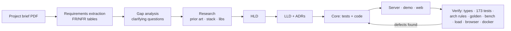

# Process: from a PDF brief to a verified, running system

The workflow is **spec-driven**: requirements → questions → research → HLD → LLD → tests → code → measurement. AI did most of the typing. Every step had a **human decision point** and a **machine-checkable gate**.

**Note on git history.** The repository history was created by importing the finished archive in logical commits, so commit timestamps do not show the build order. The order is recorded in the session notes in [prompts.md](./prompts.md).

## 1. Requirements extraction

- **Input:** the project brief, a PDF spec.
- The AI extracted the text with `pdftotext` and **rendered the pages as images**. Checking the images confirmed that nothing in the PDF was image-only (see the missing `Notification` class below).
- **Output:** traceable requirement IDs (FR-1…FR-16, NFR-1…NFR-9) in `docs/HLD.md §2`. Every FR is later mapped to code and tests in `docs/LLD.md §14`.

## 2. Gap analysis → clarifying questions (human in the loop)

The AI surfaced the gaps instead of guessing. Each was asked as a multiple-choice question with a recommended default.

**Round 1:**

| Gap | Question | Answer |
|---|---|---|
| No language specified; the API is camelCase | Which stack? | The developer pointed the AI to a reference full-stack job posting. The AI derived TypeScript / Node / React from it, so **TypeScript** |
| "You are provided with a Notification class", but it is absent from the PDF | How to handle it? | **Define it ourselves** and document the assumption |
| "Don't build beyond what is asked" vs "complete professional" | Scope? | **Core + live gateway** (SSE + tiny React client), one process |
| Optional extras | Which? | **PvP, per-type preferences, offline inbox + replay, dedup / rate limit / grouping**, all of them, built *after* the core is green |

**Round 2 (product semantics):**

| Gap | Answer |
|---|---|
| Which items count as "rare or valuable"? | Rare and above |
| Who is told about a PvP defeat? | Both players |
| What happens to muted or rate-limited notifications? | Stored silently, never dropped |
| How should bursts be grouped? | First immediately, the rest as a digest |

### Decisions the developer made

The AI proposed options and defaults. These choices were the developer's, taken from the answers above:

- **Stack:** pointed the AI to a reference full-stack job posting to decide from, then went with the TypeScript / Node / React result.
- **The missing `Notification` class:** chose to define it in the project and document the assumption, rather than guess at the original.
- **Scope:** chose core plus a live gateway (SSE and a small React client) in one process.
- **Extras:** chose all four (PvP, per-type preferences, offline inbox with replay, dedup / rate limit / grouping), to be built only after the core was green.
- **Product semantics:** "rare or valuable" means rare and above; both players are told about a PvP defeat; muted or rate-limited notifications are stored silently and never dropped; bursts are grouped as first immediately, the rest as a digest.
- **Demo video:** chose to record the real running system rather than a mock-up (session 3).
- **Budgets:** set the rule that test assertions and performance budgets are never loosened to make CI pass; the AI must ask first (session 2 prompt).

**On "don't build beyond what is asked".** The brief says not to build beyond what is asked, but also welcomes additional features after the core is complete. The reasoning was that the core had to be finished and verified first, so the extras were built only after it was green.

### Where the developer overrode or constrained the AI

Taken from the session transcripts; each item is something the AI proposed or was heading towards, and what the developer did instead. The choices the developer made from the AI's options (scope, extras, product semantics, budgets) are in the list above.

- **Stack.** The AI's first research pass was heading towards .NET: .NET 10's built-in Server-Sent Events, bounded `Channel<T>` queues, and hand-writing dispatch because MediatR and MassTransit had gone commercial. It then asked which stack to use. The developer didn't pick from the options. They sent the AI to a reference full-stack job posting to derive the stack from evidence. That gave TypeScript / Node / React, which also matches the brief's camelCase API (`gameEngine.playerLeveledUp(1, 15)`).
- **Assumptions as questions.** After the HLD and LLD, the AI had written its product rules into an "Assumptions" section and asked for a "go" to start building. The developer didn't approve them in bulk. They told the AI to ask the open rules as explicit questions first: item rarity, who hears about a PvP defeat, what muted means, and how bursts are grouped. Only the answers went into the code.
- **Guard-rails on later sessions.** When handing the project to a new session, the developer told it not to change application behaviour, user-facing messages, tests or the golden file unless a check fails.
- **Orchestrator and workers.** In the review sessions, the developer required every implementation and fix to be done by a separate, cheaper worker model (Sonnet), with the orchestrating model kept for review and judgement. Each fix had to come with a test that failed first.

## 3. Research (before design, not after)

See [research.md](./research.md). The highlights that changed the design:

- **Riot Messaging Service.** Separate the routing and edge tiers, and cache messages briefly for disconnected sessions. This produced the inbox + replay design and the v3 evolution path.
- **Discord gateway.** Deltas and streaming compression. Noted as the scale path for bandwidth.
- **Notification-system practice.** Preferences checked before send, idempotency keys under at-least-once delivery, DLQs, and per-channel isolation.
- **Platform state in Oct 2026:**
  - Node 24 is LTS, and 26 reaches LTS later this month.
  - TypeScript 7 (native) shipped in Aug 2026, but typescript-eslint and dependency-cruiser can't use it yet.
  - Fastify outperforms Express by about 2–3×.
  - MediatR and MassTransit went commercial in 2025.

## 4. Design

- **`docs/HLD.md`:**
  - Goals and non-goals, requirements, assumptions
  - C4 context and container diagrams, sequence diagrams
  - Patterns per component, technology table with alternatives
  - Delivery semantics, performance strategy, security, observability
  - Evolution path, test strategy, plan, ADR summary, "what-if" table
- **`docs/LLD.md`:**
  - Repo layout and layer matrix, TS conventions
  - Every type and port signature
  - Algorithms (bus drain, idempotency TTL, token bucket, grouping state machine, inbox ring, SSE handshake and back-pressure)
  - REST contract, config, error taxonomy, metrics, test plan, traceability
- **`docs/adr/`:** 10 decision records.

**Self-review caught design bugs before any code was written:**

- **A blocking delivery path.** The first LLD draft had the dispatcher `await` delivery. A retry with backoff would then have stalled the whole bus for every player. Delivery became fire-and-track, with the client ordering frames by `seq`.
- **Code that wouldn't compile under the chosen settings.** Draft snippets used constructor parameter properties, which `erasableSyntaxOnly` forbids. They were rewritten with `#private` fields.

## 5. Build: core first, tests alongside

**Order:** domain → ports → bus → resolvers → pipeline stages → renderer → inbox → delivery → dispatcher → composition root. Then the server, the demo and the web client.

The core compiled cleanly on the first `tsc -b`. A smoke run reproduced the brief's four messages exactly before any test was written. Then:

- **Example-based tests** for every resolver, stage, template string and adapter.
- **Property-based tests** (fast-check):
  - Dedup idempotence
  - The rate-limit bound
  - Grouping conservation (`passed + Σ groupCount = offered`)
  - Inbox `since()` correctness
  - Per-player seq ordering under random interleavings
- **Integration tests** against a real listening server and a spec-compliant SSE parser:
  - Handshake, replay, resync on restart or eviction
  - Silent replay, multi-device fan-out, heartbeats, connection caps
  - The REST contract, ingestion back-pressure (503 + Retry-After)
- **Acceptance:** the console demo is golden-file tested (`test/golden/demo.txt`).
- **Architecture:** layering rules as a test (ADR-008).

## 6. Verification, and what it caught

| Gate | What it caught |
|---|---|
| Node runtime | A regex was written with literal U+2028/U+2029 line-separator characters instead of `\u2028`/`\u2029` escapes, which is a `SyntaxError` at load. It was rewritten with the escape sequences, and the repo was scanned for any other invisible characters |
| Unit tests | A grouping test computed the wrong timeline (the test was wrong, not the code). It was fixed and an intermediate assertion added |
| Flakiness review | Two tests depended on async interleaving (DLQ retries, bus-full). Both were made deterministic: one with a per-recipient failing sender, the other with a gate that stalls the consumer |
| **Profiler** (`--cpu-prof`) | **76 µs per event / 20k events/s.** 70% of the time was in the dedup store: iterating a V8 `Map` from its head after many deletions is O(n) because of tombstones. Fixes (ADR-010): ring-buffer eviction, pooled UUID entropy, shared frozen defaults, a sync delivery fast path. Result: **5.4 µs per event / ~128k events/s** |
| Tooling | dependency-cruiser can't read TS 7, so the layering rules were rewritten as a test. Proved by injecting a violation and watching it fail |
| **Real browser** (Playwright, two players in two contexts) | The simulator's "other player → me" buttons confused a cross-player demo. They were reworked to "me → target". The friend-request toast arrived in another tab in **27 ms** |
| Load test (10k SSE connections) | p99 27 ms, but **382 MB RSS against a 300 MB target**. Reported honestly in the README rather than hidden |
| Docker | The image builds and runs: health check OK, web served, notification round-trip OK. The sandbox needed its proxy CA for `pnpm install`, handled with a test-only Dockerfile variant. The real `Dockerfile` is unchanged |
| Wording review | After the grouping digest, "Zed attacked you 3 times!" double-counted the first attack, which was already shown. It became "**3 more times**" |

## 7. Principles applied

- AI proposes; **the human decides** product questions; **machines verify** (types, tests, rules, benchmarks).
- **Research before design, design before code.** Every non-obvious choice has an ADR.
- **Measure, don't assume.** Performance claims in the docs are reproducible with `pnpm bench` and `pnpm load:sse`.
- **Report misses honestly** (the RSS target, the tooling gaps).
